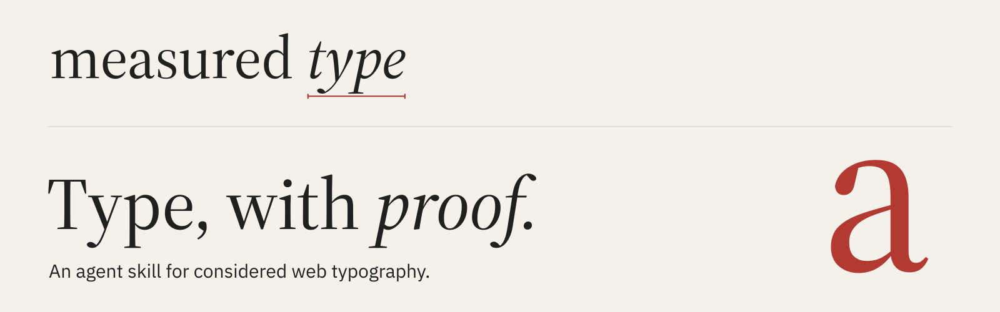
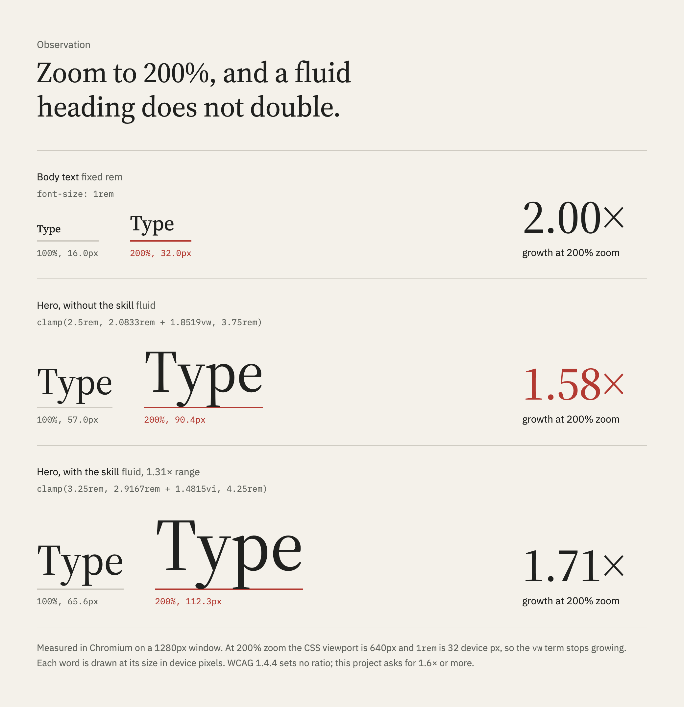

<h1><picture>
  <source media="(prefers-color-scheme: dark)" srcset=".github/brand/readme-header-dark.svg">
  <source media="(prefers-color-scheme: light)" srcset=".github/brand/readme-header-light.svg">
  
</picture></h1>

[](skills/measured-typography/SKILL.md)
[](https://skills.sh/petrilahdelma/measured-type/measured-type)
[](#evidence)
[](LICENSE)
[](https://github.com/PetriLahdelma/measured-type/commits/main)
[](https://github.com/PetriLahdelma/measured-type/stargazers)
[](https://gist.github.com/PetriLahdelma/8f94b2f1820082384e15ae2d97710060)

**[Install](#install)**&emsp;[What it prints](#what-the-tools-print)&emsp;[Evidence](#evidence)&emsp;[Read the skill](skills/measured-typography/SKILL.md)&emsp;[Docs](docs/)&emsp;[Contribute](#contributing)&emsp;[Support](#support-measured-type)&emsp;[License](#license)

Measured Type is an agent skill for web typography: Bringhurst's rules
translated into current CSS, and scripts that measure what can be measured
(line length, zoom growth, contrast, figures in a number column, font
coverage) in a real browser or in the font file. It is for frontend
developers, designers who work with an agent and typographers who want the
number beside the rule. Every claim on this page links to a committed run.

## Install

Two commands: the skill into Claude Code, then the measuring scripts.

```bash
npx skills add PetriLahdelma/measured-type --skill measured-typography --agent claude-code -g
cd ~/.claude/skills/measured-typography && npm install && npx playwright install chromium
```

The second line is optional: without it the skill advises and lints. The
browser download is about 150 MB.

Or as a Claude Code plugin from this repository's marketplace (it installs the
pinned Playwright package; add the browser as above):

```
/plugin marketplace add PetriLahdelma/measured-type
/plugin install measured-typography@measured-type
```

Installed it as `measured-type` before 10 November? Run the install line once
to move it.

The same line installs it for Codex and Cursor; the GitHub CLI route is
`gh skill install PetriLahdelma/measured-type measured-typography` (preview):

```bash
npx skills add PetriLahdelma/measured-type --skill measured-typography --agent codex -g
npx skills add PetriLahdelma/measured-type --skill measured-typography --agent cursor -g
```

The font scripts need fontTools in a Python of their own, because current
Pythons refuse a bare `pip install`; the tests read `MT_PYTHON`:

```bash
python3 -m venv ~/.venvs/measured-type
~/.venvs/measured-type/bin/pip install fonttools brotli
export MT_PYTHON=~/.venvs/measured-type/bin/python
```

Check the install with `npm test` in the skill folder (about a minute, in
headless Chromium; an installed copy skips the tests whose fonts live only in
this repository and says so). Leave out `-g` to install into one project, or
copy `skills/measured-typography` from a clone into `~/.claude/skills/`.

## The number, before you install

<p>
<picture>
  <source media="(prefers-color-scheme: dark)" srcset=".github/brand/zoom-200-dark.png">
  <source media="(prefers-color-scheme: light)" srcset=".github/brand/zoom-200-light.png">
  
</picture>
</p>

| At 200% zoom on a 1280px window | 100% | 200% | Growth |
|---|--:|--:|--:|
| Body text, `1rem` | 16.0px | 32.0px | 2.00× |
| Hero written without the skill | 57.0px | 90.4px | 1.58× |
| Hero written with the skill | 65.6px | 112.3px | 1.71× |

Zoom doubles `rem` but halves the CSS viewport, so the viewport term in a
fluid size stops growing. WCAG 1.4.4 sets no ratio of its own; the 1.6× bar
is this project's.

## What the tools print

One report format for the rendered audit and the source lint: rule id,
severity, where, the measured value, the CSS fix, a verdict and what could not
be checked. An ops dashboard from the head-to-heads, Fix column and most rows
left out:

| Severity | Rule | Location | Measured |
|---|---|---|---|
| HIGH | MT-CONTRAST | `p.foot` | 2.23:1 (rgb(170, 170, 170) on rgb(250, 250, 250), needs 4.5:1) |
| HIGH | MT-REFLOW | `table.services` at 320 CSS px (400% zoom of 1280) | page is 924px wide in a 320px viewport |
| MEDIUM | MT-TABULAR | `table.services` columns 3, 4 and 5 | 1 and 0 differ by 26.8% in width, so digits do not line up |
| LOW | MT-TRUNCATE | `td > span.name` | "Authentication gateway for partner accounts" cut at 1280px |

Verdict: Block (9 HIGH).

Line length is counted, not trusted: `66ch` is sixty-six zeros wide, and the
zero is wider than most letters. `measure-line.js` counts the rendered lines
and solves for the width that gives the number asked for:

```text
.prose > p at 1280px, zoom 1: 90.6 chars/line (long (over 75))
  range 82-96 over 13 full lines in 4 paragraphs
  declared Georgia, "Times New Roman", serif 18px, line-height 27.9px
  leading 1.55 at 90.6 chars/line: house floor 1.40 for this length
  rendered with Georgia (system font, 350 glyphs)
  content box 729.2px = 66ch = 40.5em
  zero 0.614em vs average character 0.432em
solve 66: max-inline-size: 29.8em (536.4px) gives 66.1 chars/line on .prose > p
```

Without a browser, `lint-css.js` and `estimate-measure.js` need only Node and
`page-audit.js --lite` lists every check it skipped. The scripts, what each
reads and the exit codes: [docs/tools.md](docs/tools.md).

## Where it helps, what it costs, when to skip it

**Where it helps.** Line length in a wide face (`66ch` in Verdana sets 81
characters; the skill counts lines). Fluid type under zoom when the brief
fixes the sizes (`type-scale.js --fit` keeps both and passes the zoom bar; on
a held-out case every run with the skill met all three checks, none without
it). Right-to-left audits that convert text flow and leave decoration alone.
Dense product UI: tabular figures, numbers aligned at the end, tracked
capitals, truncated text, contrast in both colour schemes. Links marked by
colour alone; leading too tight for the line length. Teams: one report with
rule ids and a verdict that can gate a pull request.

**What it costs.** 7% to 25% more tokens and up to twice the time per task,
measured across every experiment; `npm install` and a Chromium download for
the measuring scripts; a CC BY-NC 4.0 text whose use in paid client work is
not settled ([License](#license)).

**When to skip it.** Fluid type under zoom on its own, where one sentence
("check that it still grows at least 1.6× at 200% zoom") matched the skill on
the held-out case; one-off questions a current model answers well; logos,
drawing icons or fonts, build setup.

Installed in a project, it loaded before the agent's first edit on every
typography prompt with Opus 5.5 (26 of 26) and on 15 of 16 with Sonnet 5.5,
and never on a near miss ([spec 0016](specs/0016-triggering-in-session.md),
repeated on 5 November 2026); other type or design skills installed alongside
it were not tested, so name it when you want it for certain.

## How it works

1. **Classify the text.** Reading, display and interface text follow
   different rules.
2. **Direction and language first.** Every rule is flow-relative, with `lang`
   and `dir` as inputs, so an RTL edition is a content change.
3. **Decide with the rules.** Bringhurst's [*The Elements of Typographic Style*](https://www.amazon.com/dp/0881792128),
   numbered so reviews can cite `§2.1.2`, in CSS that ships today.
4. **Measure what can be measured;** without a browser, estimate and say so.
   What a check cannot compute is listed under Not verified.
5. **Review with a point of view.** A taste reference for what reads as
   considered.

The rules by decision (how wide a column, a scale that survives zoom, where
hard spaces go, right to left): [docs/reference.md](docs/reference.md).

## Use it

Name the skill for a first task, in a project with a stylesheet:

> *Use measured-typography to audit the typography in styles.css and fix the HIGH findings. Measure the line length in the browser.*

After that it loads on its own when a request touches how words and numbers
sit on a page. Tasks it is written for: *set the article body in Verdana at
1.125rem, about 66 characters per line*; *build a type scale that still works
at 200% zoom*; *audit this stylesheet before the Arabic edition*; *the numbers
in our admin table don't line up*. It works alongside general frontend and
design-system skills: they keep layout and components, this one makes the
type decisions inside them.

## In CI and pull requests

The linter exits 1 when a HIGH finding remains, so it can gate a pull request
with no install, and `--diff` limits it to what the branch changed:

```bash
node path/to/measured-typography/scripts/lint-css.js src --diff origin/main
```

The rendered audit needs Playwright and a page: point it at a preview
deployment or a built HTML file. Exit codes: 0 approve, 1 block, 2 usage
error, 3 when the browser is missing and the lite report stood in
([docs/tools.md](docs/tools.md#in-ci-and-pull-requests)).

## Evidence

Fourteen experiments, every case and grader committed before the runs, and
the tools on 100 public pages. With a browser, a model without the skill
measures line length and fixes the same faults; the skill adds precision (a
quarter of a character off 66 against 0.68); without a browser its estimate
beats a guess by about a character; on fluid type under zoom,
`type-scale.js --fit` moved the result (20 of 20 runs against 0 of 20) and a
one-sentence hint matched it on the held-out twin; the guidance alone changed
nothing measurable on cases written after the content was frozen. On the 100
pages, lines run long (median 78.7 characters) and colour-only links fail on
14, each check confirmed by re-measuring. Table, method and proofs:
[docs/evidence.md](docs/evidence.md).

## Pairs with Rhythmguard

[**Rhythmguard**](https://github.com/PetriLahdelma/stylelint-plugin-rhythmguard),
a Stylelint plugin by the same author, keeps every spacing value (and, opt in,
every type size) on your scale; Measured Type decides whether the scale reads
well. They meet at the type scale (`type-scale.js --prefix font-size` writes
tokens Rhythmguard reads) and at the baseline grid (Rhythmguard keeps the
source on a cadence, `page-audit.js --baseline` measures where the text
lands). What each finds that the other leaves alone:
[docs/tools.md](docs/tools.md#pairs-with-rhythmguard).

## Contributing

Corrections, wrong results and new eval cases are the most useful
contributions, and each has an issue form that asks for what makes it
checkable. [CONTRIBUTING.md](CONTRIBUTING.md) covers the setup, the
spec-and-test-first workflow, the house style and how an eval is
pre-registered and reported; questions go to
[Discussions](https://github.com/PetriLahdelma/measured-type/discussions) and
changes to the [changelog](CHANGELOG.md). Everyone taking part follows the
[Code of Conduct](CODE_OF_CONDUCT.md); security problems are reported
privately ([SECURITY.md](SECURITY.md)).

## Support Measured Type


Measured Type is free to use; if it saves you time, optional sponsorship helps
keep it measured and maintained. The identity and its artwork:
[docs/identity.md](docs/identity.md).

[](https://github.com/sponsors/PetriLahdelma)
[](https://buymeacoffee.com/petrilahdey)

## License

Text (SKILL.md, references and eval prose) is CC BY-NC 4.0 because it adapts
Richard Rutter's [webtypography.net](https://webtypography.net), which is
published under that license. Scripts are MIT. Contributions take the license
of the files they change ([CONTRIBUTING.md](CONTRIBUTING.md#licensing-of-contributions)). The test fonts are under the
SIL Open Font License. The Measured Type name and the artwork in
`.github/brand/` identify this project and are not licensed for other use.
See [LICENSE](LICENSE); the skill folder carries its own copy of the notices,
so an installed skill keeps them.

**Can I use it in paid work?** The scripts, MIT, can be used anywhere. The
text is CC BY-NC 4.0, which restricts uses primarily intended for commercial
advantage. Whether an agent consulting it during paid client work is such a
use has not been settled with the rights holders; this README does not
settle it. If it matters for your work, read the license or ask before you
rely on it.

The rules follow Robert Bringhurst's
[*The Elements of Typographic Style*](https://www.amazon.com/dp/0881792128) and
the rule order of webtypography.net. They are paraphrased and the CSS is
rewritten for current browsers. The skill is a working translation, not a
substitute: if it is useful to you, buy the book.

Measured Type is an independent project. It is not affiliated with, endorsed
by or sponsored by Robert Bringhurst, Richard Rutter, webtypography.net, Matej
Latin, Ina Saltz or the publishers of their books; their names appear only to
credit the sources.
