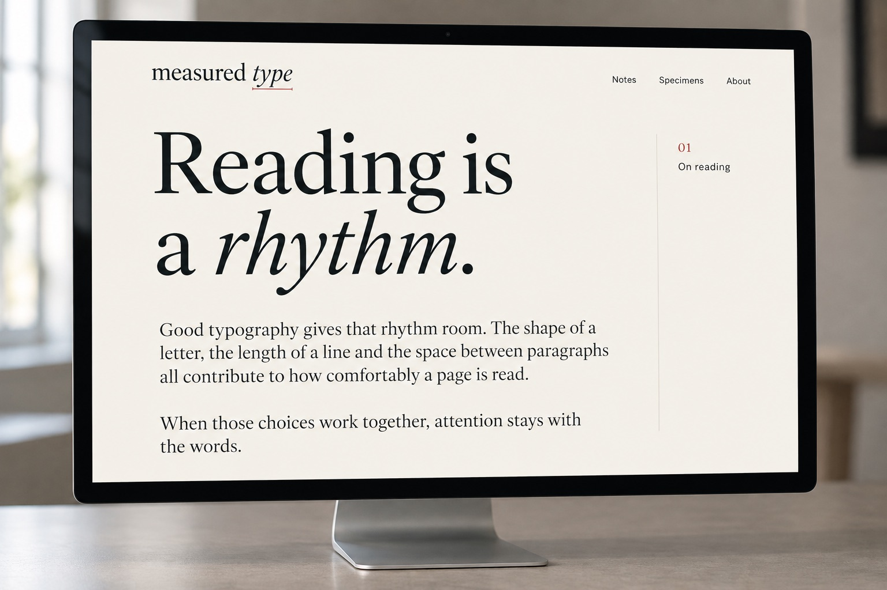
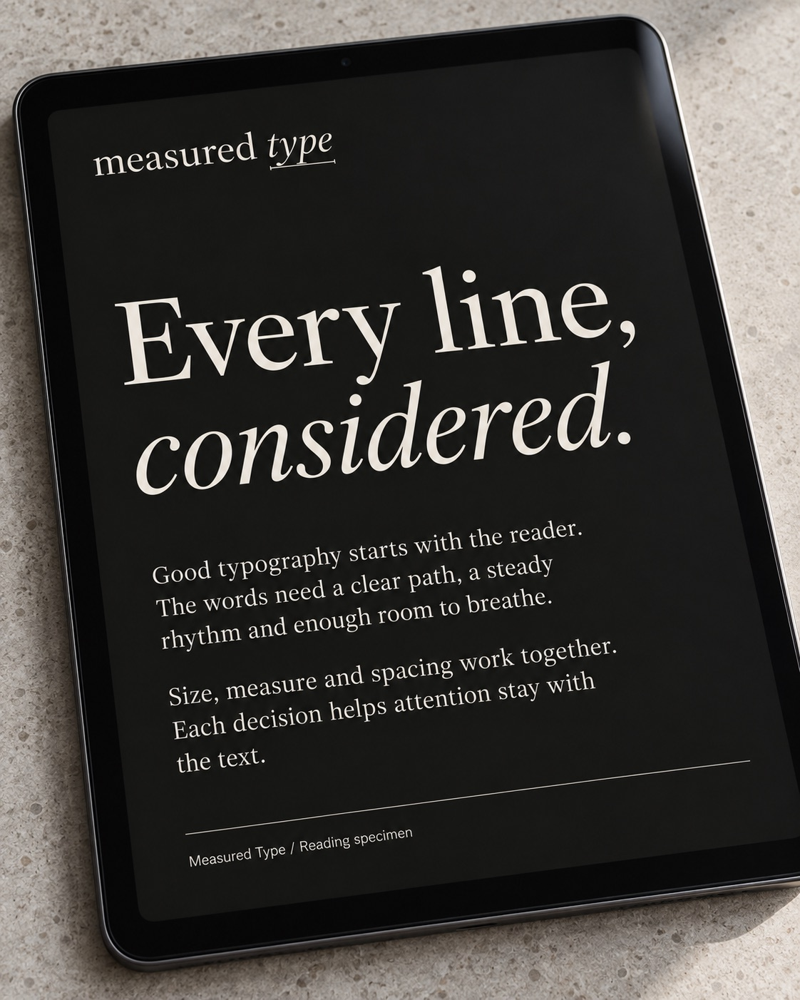
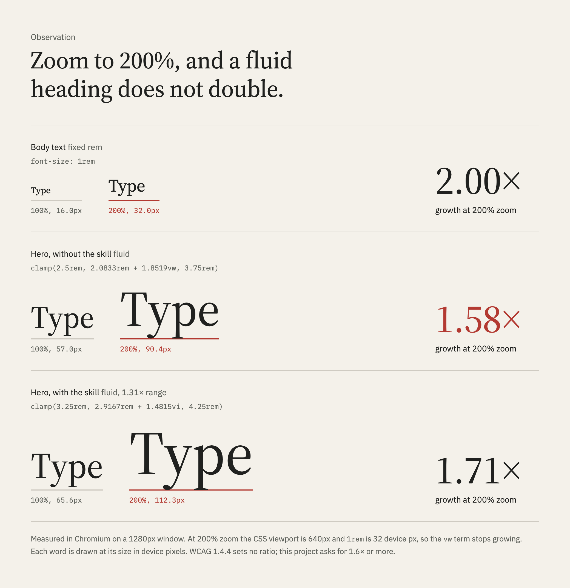
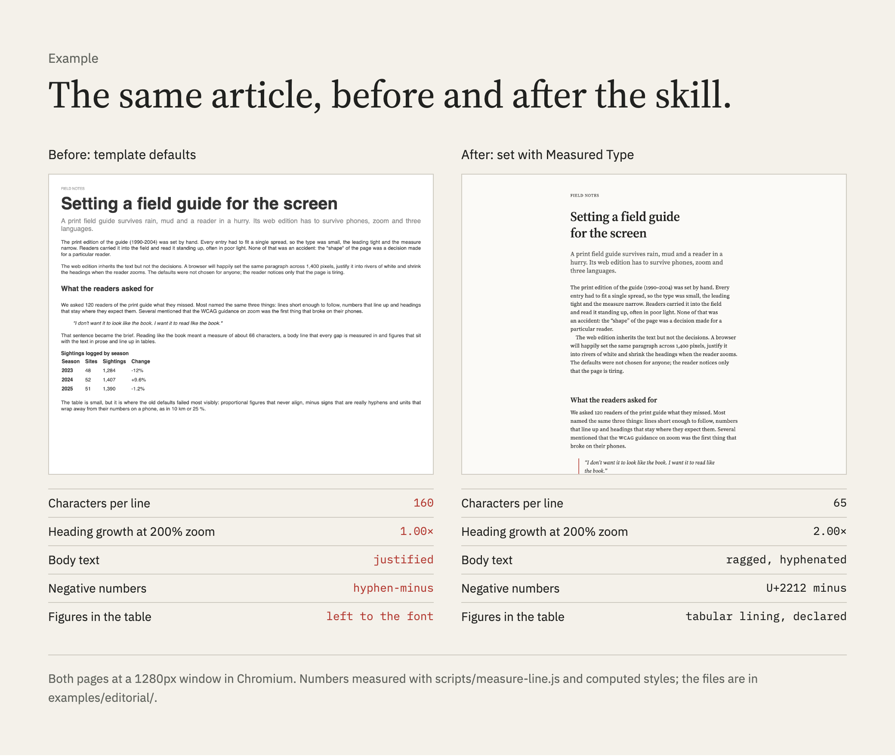

<h1><picture>
  <source media="(prefers-color-scheme: dark)" srcset=".github/brand/readme-header-dark.svg">
  <source media="(prefers-color-scheme: light)" srcset=".github/brand/readme-header-light.svg">
  
</picture></h1>

[](skills/measured-type/SKILL.md)
[](#evidence)
[](LICENSE)
[](https://github.com/PetriLahdelma/measured-type/commits/main)
[](https://github.com/PetriLahdelma/measured-type/stargazers)

**[Install](#install)**&emsp;[Read the skill](skills/measured-type/SKILL.md)&emsp;[View the evaluations](evals/results/iteration-2/benchmark.md)&emsp;[Support](#support-measured-type)&emsp;[License](#license)

Measured Type brings typographic judgment into a coding agent's workflow, with
tools for checking the parts that can be measured. It is for design engineers,
frontend developers and design-system teams who use agents to set and review
text.

Most typography advice ends at a rule of thumb. This skill goes one step
further: when a claim can be checked, it is checked in a browser or against the
font file. The number goes into the answer.

<p>
  
  
</p>
<sub>Illustrations of the identity, not measurements. The measured evidence starts at
<a href="#proof-not-rules-of-thumb">Proof, not rules of thumb</a>.</sub>

## Install

**skills CLI** ([skills.sh](https://skills.sh)), for Claude Code as a personal
skill available in every project:

```bash
npx skills add PetriLahdelma/measured-type --skill measured-type --agent claude-code -g
```

Leave out `-g` to install into the current project's `.claude/skills/`, or
leave out `--agent` to choose other agents interactively. Tested with skills
1.7.4 on macOS, 29 October 2026.

**Claude Code without the CLI**, as a personal skill:

```bash
git clone https://github.com/PetriLahdelma/measured-type.git
```

```bash
cp -R measured-type/skills/measured-type ~/.claude/skills/
```

For one project only, copy it to `.claude/skills/` in that repository instead.

**GitHub CLI** (`gh skill`, preview), for Claude Code or any other supported
agent:

```bash
gh skill install PetriLahdelma/measured-type measured-type --agent claude-code --scope user
```

**Try it without installing anything.** The source linter and the measure
estimate need only Node, no `npm install` and no browser:

```bash
node ~/.claude/skills/measured-type/scripts/lint-css.js src
```

```bash
node ~/.claude/skills/measured-type/scripts/estimate-measure.js "Verdana" 66ch
```

The linter reads CSS, Sass, Less, HTML, the `<style>` blocks of Vue, Svelte
and Astro files and Tailwind classes in markup and JSX. The estimate comes
from a Chromium calibration of 30 faces and says so. Without a browser,
`page-audit.js` falls back to a lite mode that lints the page's own
stylesheets and lists every rendered check it skipped.

**The measuring scripts** are optional. The skill works without them but cannot
measure:

```bash
cd ~/.claude/skills/measured-type && npm install && npx playwright install chromium
```

```bash
pip install fonttools brotli
```

**Check the install.** The scripts ship with regression fixtures; run them in
the folder the skill was installed to and every test should pass. A few skip in
an installed copy because their fixtures (the editorial example, the test
fonts) live in this repository:

```bash
cd ~/.claude/skills/measured-type && npm test
```

That proves the measuring works. To check that the skill itself loads, ask
Claude Code *Which measured-type rule covers line length?* The answer should
cite §2.1.2 and point to `measure-line.js`.

Then ask by name to be sure the skill loads. In tests of sixteen typography
prompts it loaded on its own in only about one run in ten
([triggering eval](evals/triggering/README.md)); a prompt that names it
(*Use measured-type to …*) loaded it every time. A first task
that shows what it adds, run in a project with a stylesheet:

> *Use measured-type to audit the typography in styles.css and fix the HIGH findings. Measure the line length in the browser.*

Tasks it is written for:

- *Set the article body for our docs in Verdana at 1.125rem, about 66 characters per line.*
- *Build a type scale for this site that still works at 200% zoom.*
- *Audit this stylesheet before we ship the Arabic edition.*
- *Does our italic have real small caps?*
- *The numbers in our admin table don't line up and the status badges are hard to read.*

It works alongside general frontend and design-system skills: they keep
layout and components, this one makes the type decisions inside them.

## What it catches

Each row is a finding from the committed benchmark (iteration 2, run on the
current skill), in the words the skill uses to report it. The right column says
whether the baseline's miss was an error a reader would see or a convention the
skill teaches.

| Observation | In the benchmark |
|---|---|
| **The heading grows too little under zoom.** A `clamp()` with a viewport term does not double when the reader zooms to 200%. | Without the skill, both runs let the hero grow only 1.58× at 200% zoom, under the grader's 1.6× bar. That bar is this project's, not WCAG's: 1.4.4 sets no ratio and both heroes pass the common max ÷ min ≤ 2.5 heuristic. With the skill, both runs did the ratio math first and reached 1.67× and 1.71×. |
| **`75ch` in Verdana is not 75 characters.** `1ch` is the width of the zero, which is wider than the average letter. | Both runs without the skill knew that `1ch` is the zero. Neither counted: both kept `75ch` for the Latin text, which renders 92 characters per line. A reader would see this one. |
| **`>` already mirrors.** Bidi-mirrored characters flip by themselves in right-to-left text; swapping them as well flips them back. | One run without the skill said `>` used as an arrow needs an explicit RTL swap, which would point it the wrong way again. A reader would see this one too. |
| **The shadow is decoration, not direction.** An RTL audit converts text flow and leaves decorative offsets alone. | Both runs without the skill mirrored the decorative `box-shadow`, one the `rotate()` as well. Whether decoration mirrors is a design call; the skill's answer is no. |
| **The qualifier can break from its number.** "up to 18 h" needs hard spaces in two places, not one. | One run without the skill left a plain space inside "up to". Its `white-space: nowrap` kept the page from breaking there; the hard space keeps the phrase together wherever the text is reused. |
| **The italic file has no small-cap substitutions.** A feature tag in the roman says nothing about the italic. | All eight runs across both iterations caught this; the bundled script makes it a one-command check instead of a careful reading. |

The references also cover traps the benchmark does not test: `rlh` is the body
line only when the body is set at the root size; `Intl.NumberFormat` with
`style: 'unit'` emits a plain space that lets "18 h" break. A half-line margin
under a heading collapses into the next element's full-line margin, so the half
line silently becomes a full one.

## Proof, not rules of thumb

<picture>
  <source media="(prefers-color-scheme: dark)" srcset=".github/brand/zoom-200-dark.png">
  <source media="(prefers-color-scheme: light)" srcset=".github/brand/zoom-200-light.png">
  
</picture>

| At 200% zoom on a 1280px window | 100% | 200% | Growth |
|---|--:|--:|--:|
| Body text, `1rem` | 16.0px | 32.0px | 2.00× |
| Hero without the skill | 57.0px | 90.4px | 1.58× |
| Hero with the skill | 65.6px | 112.3px | 1.71× |

This is the case where the skill and the model differ most. Zoom doubles `rem`
but halves the CSS viewport, so the viewport term in a fluid size stops
growing. Without the skill, both benchmark runs shipped heroes like the second
row; with it, both did the ratio math first and kept the fluid range narrow.
WCAG 1.4.4 sets no ratio of its own; the 1.6× bar is this project's.

<picture>
  <source media="(prefers-color-scheme: dark)" srcset=".github/brand/measure-66ch-dark.png">
  <source media="(prefers-color-scheme: light)" srcset=".github/brand/measure-66ch-light.png">
  
</picture>

| `max-inline-size: 66ch` at 16px | Verdana | Source Serif 4 |
|---|--:|--:|
| Width of the zero, `1ch` | 0.64em | 0.52em |
| Box width | 671px | 548px |
| Characters per full line | 81 | 70 |

Every number in this figure was counted in the rendered page, not computed from
the CSS. The same count is one command away. Asked for about 66 characters per
line in Verdana, the skill set the box in `em`, not `ch`, then checked it:

```bash
node scripts/measure-line.js --css prose.css
```

```text
.prose > p at 1280px, zoom 1: 66.1 chars/line (inside 45-75)
  range 60-71 over 20 full lines in 4 paragraphs
  declared Verdana, "DejaVu Sans", "Bitstream Vera Sans", sans-serif 18px, line-height 28.8px
  rendered with Verdana (system font, 350 glyphs)
  content box 621px = 54.3ch = 34.5em
  zero 0.636em vs average character 0.504em
```

`54.3ch` for 66 characters: the last line says why.

### Font files, not font names

A feature tag is not coverage. `scripts/font-features.py` reads the file and
counts what each text feature actually maps. Source Serif 4 is a good example:
the roman has complete small caps and the italic has none.

```bash
python3 scripts/font-features.py "SourceSerif4-Italic[opsz,wght].ttf" --check smcp=abcdefghijklmnopqrstuvwxyzäöå
```

```text
# Source Serif 4 Italic  (SourceSerif4-Italic[opsz,wght].ttf)
italic: yes
default figures: tabular lining
GSUB: aalt case ccmp dnom frac liga lnum locl numr onum ordn pnum sinf ss01 ss02 ss03 subs sups tnum zero

  smcp: ABSENT  (small caps from lowercase: should cover a-z and accented letters)
  c2sc: ABSENT  (small caps from capitals: should cover A-Z and accented capitals)

check smcp: absent
  missing: abcdefghijklmnopqrstuvwxyzäöå
```

(Excerpt; the full report lists every feature with its coverage.)

The same habit applies to metrics. A variable font's metadata describes one
instance, while the outline at the size you set is what the reader sees:

<picture>
  <source media="(prefers-color-scheme: dark)" srcset=".github/brand/x-height-specimen-dark.png">
  <source media="(prefers-color-scheme: light)" srcset=".github/brand/x-height-specimen.png">
  
</picture>

At weight 450 and optical size 60, the drawn x of Source Serif 4 is 0.453em
tall. The `OS/2` table's `sxHeight` says 475 units, which matches the outline
only at the default optical size of 20; at 8 the x stands 0.509em. Position a
rule from the outline at the optical size in use and it lands on the letter.

### One article, before and after



[`examples/editorial/`](examples/editorial/) holds both versions and a table of
every change with the section it follows: measure, leading, rhythm in whole body
lines, paragraph marking, figures, small caps, minus signs, hard spaces and
logical sides.

## Tools

Six scripts turn the rules into numbers. Each one has tests that were written
before it ([`specs/0001-measured-tools.md`](specs/0001-measured-tools.md),
[`0002`](specs/0002-book-checks.md), [`0003`](specs/0003-product-ui-lite-and-sources.md)), and
the two audits share one report format: severity, rule ID, location, the
measured value, the CSS fix and a Block or Approve verdict
([`references/audit.md`](skills/measured-type/references/audit.md)).

| Script | What it measures |
|---|---|
| [`page-audit.js`](skills/measured-type/scripts/page-audit.js) | A rendered page at 1280, 768 and 375px and at 200%, 400% and 500% zoom: reflow, characters per line, contrast, the WCAG 1.4.12 spacing override, fonts that fell back, heading zoom growth; and from Latin and Saltz, inline code x-height, kerning switched off, I and l alike, heading order and spacing, the family budget, x-height pairing, thin weights with APCA Lc, hairlines on dark grounds and icon alignment; for dense product UI, tabular figures and end alignment in number columns, tracked capitals, truncated text (also at 200% zoom) and interface text under 12px. `--lite` without a browser |
| [`lint-css.js`](skills/measured-type/scripts/lint-css.js) | CSS, Sass, Less, HTML, Vue, Svelte, Astro, JSX and Tailwind classes, or only what a pull request changed (`--diff`): fluid sizes evaluated at 200% and 500% zoom, length line-heights, `62.5%` roots, justification, `ch` measures with an estimate for known faces, physical sides (with the logical Tailwind utility), untracked capitals, hyphen-minus and straight quotes. No dependencies |
| [`measure-line.js`](skills/measured-type/scripts/measure-line.js) | Characters per line of one selector, graphemes and columns counted correctly |
| [`estimate-measure.js`](skills/measured-type/scripts/estimate-measure.js) | Characters per line for a face and a width without a browser, from a Chromium calibration (within 6% of the rendered count in the tests) |
| [`fallback-metrics.py`](skills/measured-type/scripts/fallback-metrics.py) | A metric-matched fallback `@font-face` from the font files, so the web font swaps in without reflow |
| [`type-scale.js`](skills/measured-type/scripts/type-scale.js) | Fluid `clamp()` tokens, each checked for range, zoom growth and step ratio before it is printed |

```bash
node scripts/page-audit.js examples/editorial/before.html
```

```text
| Severity | Rule | Location | Measured | Fix |
|---|---|---|---|---|
| HIGH | MT-CONTRAST | `article.prose > p.kicker` | 2.85:1 (rgb(153, 153, 153) on rgb(255, 255, 255), needs 4.5:1) | darken the text or lighten the ground to reach the ratio |
| HIGH | MT-REFLOW | `article.prose > table at 320 CSS px (400% zoom of 1280)` | page is 355px wide in a 320px viewport | max-inline-size instead of fixed widths; let tables scroll inside a wrapper |
| HIGH | MT-ZOOM-VW | `article.prose > h1` | 56.32px grows 1.00× at 200% and 1.00× at 500% zoom | clamp(min-rem, rem + vi, max-rem) with a range near 1.4× |
| MEDIUM | MT-MEASURE-LONG | `article.prose > p at 1280px` | 159.5 characters per line (range 155-166) | max-inline-size in em, counted to about 66 with measure-line.js |

Verdict: Block (4 HIGH)
Not verified: Safari and Firefox rendering (Chromium only)
```

(Excerpt: the full report has nine rows, including a Helvetica standfirst whose I and l the new glyph check flags.) The same audit approves `after.html`.

## How it works

1. **Classify the text first.** Reading, display and interface text follow
   different rules; book rules applied to a button are their own mistake.
2. **Direction and language before anything else.** Every rule is written
   flow-relative, with `lang` and `dir` in place, so an RTL or vertical edition
   is a content change rather than a rewrite.
3. **Decide with the rules.** Bringhurst's [*The Elements of Typographic Style*](https://www.amazon.com/dp/0881792128),
   numbered so reviews can cite `§2.1.2`, translated into CSS that ships today.
4. **Measure what can be measured.** Characters per line, zoom ratios,
   rendered hard spaces, font coverage.
5. **Review with a point of view.** A taste reference for what reads as
   considered and for the template tells that read as defaults.

## Reference, by decision

Open the part that answers the question in front of you.

| You are deciding | Read |
|---|---|
| How wide a column of text should be | [Choose a comfortable measure](skills/measured-type/references/rules.md#212-choose-a-comfortable-measure), then [`measure-line.js`](skills/measured-type/scripts/measure-line.js) |
| Leading and the space between blocks | [Vertical space in measured intervals](skills/measured-type/references/rules.md#222-add-and-delete-vertical-space-in-measured-intervals) |
| A type scale that survives zoom | [Building or reviewing a type scale](skills/measured-type/SKILL.md#building-or-reviewing-a-type-scale) and [Don't compose without a scale](skills/measured-type/references/rules.md#311-dont-compose-without-a-scale) |
| Whether a font has real small caps or text figures | [Checking what a font contains](skills/measured-type/references/rules.md#checking-what-a-font-contains), then [`font-features.py`](skills/measured-type/scripts/font-features.py) |
| Spacing for capitals, labels and acronyms | [Letterspace capitals and small caps](skills/measured-type/references/rules.md#216-letterspace-capitals-small-caps-and-long-digit-strings) |
| Data tables, labels, badges and status text | [Dense product UI](skills/measured-type/references/product-ui.md) |
| Where hard spaces go | [Link short numerical expressions](skills/measured-type/references/rules.md#246-link-short-numerical-expressions-with-hard-spaces) |
| Making a layout work right to left | [Physical to logical map](skills/measured-type/references/logical-and-language.md#physical-to-logical-map) and [Mirroring](skills/measured-type/references/logical-and-language.md#mirroring) |
| Quotes, decimals, units and dates for a locale | [Locale conventions](skills/measured-type/references/logical-and-language.md#locale-conventions-the-pattern), worked for English, Finnish and Swedish |
| Replacing CSS that was renamed or never shipped | [Renamed, dead or wrong](skills/measured-type/references/css-modern.md#renamed-dead-or-wrong) |
| Whether the result looks considered | [Reviewing with a point of view](skills/measured-type/references/taste.md#reviewing-with-a-point-of-view) |

## Evidence

**Method.** Five eval cases, each run twice with the skill and twice without it,
on Claude Opus 5.5. Iteration 1 ran on 29 October 2026; iteration 2 reran both
configurations the same day on the skill as fixed after review (commit
`313a165`), with the same prompts, assertions, grader brief and model. Graders
read only the files each run produced. Rendered claims (line length, zoom
ratios, the characters in the DOM) were measured in Chromium, not read off the
source.

**A development set, not a held-out test.** The references were written while
these cases existed and contain worked answers for some of them: the three
faces measured at 18px, the italic without small caps, `jopa 18 h` and the
list-indent trap. The review fixes added one more: the rhythm section now
states the whole-line heading rule that a measure-wide-face assertion checks.
The results show that the skill's content reaches the agent and changes its
output; they do not show how it does on problems nobody wrote down in advance.

| Case | With skill | Without | Iteration 1 | What decides it |
|---|--:|--:|--:|---|
| zoom-safe-scale | 10/10 | 5/10 | 10/10 vs 4/10 | Hero at 1.6× or more at 200% zoom (a house bar); h3 and h4 still 1.15× apart at 360px; spacing from the body line |
| physical-props-audit | 26/26 | 21/26 | 25/26 vs 22/26 | Decoration left physical; `75ch` in Verdana named as 92 characters; no double mirroring |
| rendered-nbsp-spec-table | 12/12 | 9/12 | 12/12 vs 9/12 | Logical properties; "up to" bound to its number |
| ofl-feature-check | 16/16 | 16/16 | 16/16 vs 15/16 | No longer separates: every run read the font files correctly |
| measure-wide-face | 14/14 | 14/14 | 14/14 vs 13/14 | No longer separates: every run measured Verdana itself |
| **All assertions** | **78/78** | **65/78** | **77/78 vs 63/78** | Mean per-run pass rate 100% against 81% (iteration 1: 99% against 77%) |

**What the 13 baseline misses are.** Three are errors a reader would see: both
audits kept a `75ch` measure that renders 92 characters and one proposed a
swap that would mirror `>` twice. One is a content requirement the page did
not show: the plain space in "up to" that CSS already kept from breaking. The
other nine are conventions and house thresholds the skill teaches: the 1.6×
zoom bar, the 1.15× step floor, spacing tokens derived from the body line,
logical properties on a page with no RTL requirement and decoration left
unmirrored. They are deliberate positions and the graders hold them strictly;
another careful typographer could choose differently on several. Iteration
1's 15 misses split into 2 visible errors, 1 content requirement and 12
conventions.

**Grading caveats.** One measure-wide-face assertion reads two ways ("whole or
half" lines, yet wrapped headings must land on the interval). Iteration 2 was
graded the way iteration 1 was; the strict reading would take a point from
both baselines in iteration 2 and from one run of each configuration in
iteration 1.
Graders differed slightly between iterations on how literally a review must
name each property. The benchmark notes list every judgment call.

**Held-out cases.** Three more cases were written after the skill content was
frozen (tag `content-freeze-1`) and committed before any run: a sidenote layout
with two measures, an English results table and Swedish docs on a 320px screen.
With the skill 32/34, without 33/34. Every run, with or without the skill,
measured its own line lengths and got minus signs, tabular figures, table
header scopes, Swedish hyphenation and unbreakable table values right. Both
with-skill misses are literal readings of the pre-registered wording (figures
aligned by a grid track instead of `text-align`; `hyphens` reset on `code` but
not on its `pre`); read by intent, both configurations score 34/34. A rerun on
`content-freeze-2` gave 34/34 against 33/34. On these problems, which nobody
wrote answers for in advance, the skill made no measurable difference.

**Does it load on its own?** Twenty prompts in
[`evals/triggering/`](evals/triggering/), each run three times with the skill
offered and user-level skills switched off. It never loaded for the ten near
misses (Tailwind setup, a font-renaming script, a logo for a typography
newsletter). It loaded reliably for one of the ten typography tasks ("Review
the typography in landing.css") and one time in three for two more. Tuning the
description with skill-creator's optimization loop (`content-freeze-2`) moved
the average load rate on typography tasks from 13% to 23%, and from 17% to 22%
on twelve fresh prompts written before the tuning finished: within noise, with
still no false loads. A run counts only when opening the skill is the agent's
first move, so these are lower bounds, but the message is plain: name the
skill when you want it.

**Against other typography skills.** Three more cases (a page audit with a
fix, a no-jump web-font setup and an Arabic edition from one stylesheet) ran
under seven configurations, two runs each: no skill, Measured Type,
Anthropic's frontend-design, impeccable, better-typography,
practicaltypography and wondelai's web-typography. Cases and graders were
committed before the runs, run folders were anonymized and every assertion is
measured in Chromium.

| Configuration | Frozen graders | Corrected graders | Mean time | Mean tokens |
|---|--:|--:|--:|--:|
| Measured Type | **40/40** | **40/40** | 298 s | 164k |
| frontend-design | 38/40 | **40/40** | 240 s | 145k |
| No skill | 38/40 | 39/40 | 293 s | 139k |
| impeccable | 37/40 | 39/40 | 409 s | 168k |
| practicaltypography | 37/40 | 39/40 | 327 s | 153k |
| better-typography | 37/40 | 38/40 | 241 s | 149k |
| wondelai web-typography | 37/40 | 38/40 | 237 s | 153k |

Measured Type is the only configuration that passed every assertion under
both graders. Under the corrected graders frontend-design ties it, so the
pre-registered bar (more than every other configuration) is met only as
frozen. The correction replaced one RTL assertion that read the CSS source
instead of the rendered page and failed nine correct answers; the
[results](evals/results/h2h-1/) give both scores and every disclosure. The
spread is small: no configuration fell below 37 of 40. What separated them
was counting every reading block (five runs left a byline at 79 characters
per line) and not mirroring a `›` the browser already mirrors.

**Head-to-head 2** added two harder cases after an outside review asked for
dense product UI: an ops dashboard (9 rendered assertions) and "about 66
characters per line" in Verdana, where `66ch` sets 79. Measured Type and no
skill both scored 24 of 24; the skill used 9 to 12% more tokens. Every run was
told a browser was available, and every run without the skill used it to
measure, found the `66ch` trap and fixed all nine dashboard faults. On this
model, with a browser in reach, the skill's measured advantage is small to
none ([results and limits](evals/results/h2h-2/)).

**Head-to-head 3** removed the hint: no browser in the brief, nothing to
install, and Sonnet 5.5 added next to Opus 5.5. All 16 runs again passed
every assertion. The difference showed in how close they came: with the
skill, every run measured in Chromium and set 66.0 to 66.4 characters per
line; without it, two runs estimated Verdana's widths from memory and landed
at 62.5 and 63.4, inside the graded band but short of the 66 asked for. The
skill buys precision and a measured claim instead of an estimate, at 7 to 14%
more tokens ([results and limits](evals/results/h2h-3/)).

**Scope.** Gains concentrate in specific cases. A current model without the
skill already knows most typographic CSS, measures line length on its own when
it can, reads font files correctly and gets locale number formatting right. The
skill earns its place where the model would otherwise trust a formula: fluid
type under zoom (the largest gap in both iterations, measured against the
house bar), RTL audits that convert text flow without touching decoration and
small details such as binding a qualifier to its number. With two runs per
configuration, treat a one-assertion difference as noise.

**Cost.** In iteration 2, runs with the skill took about 100 seconds and 32k
tokens more each (iteration 1: 35 seconds and 21k), spent reading the longer
references and running more checks.

The outputs, grades and timings of every run are in
[`evals/results/iteration-2/`](evals/results/iteration-2/),
[`iteration-1/`](evals/results/iteration-1/),
[`heldout-1/`](evals/results/heldout-1/),
[`heldout-2/`](evals/results/heldout-2/) and
[`h2h-1/`](evals/results/h2h-1/).

## Running the evals

The cases in `evals/` use the layout that `claude plugin eval` and the
skill-creator workflow read: `prompt.md`, `case.yaml`, one grader file per
assertion and input files under `files/`. Cases named `heldout-*` were written
after `content-freeze-1`. The runs read the skill directly, so they measure its
content; `evals/triggering/` measures whether it loads, with skill-creator's
`run_eval.py`. To recheck a committed result:

```bash
node skills/measured-type/scripts/measure-line.js --css evals/results/iteration-1/measure-wide-face/with_skill/run-1/outputs/prose.css
```

The `ofl-feature-check` and `heldout-results-table` outputs reference `fonts/`;
copy the case's `files/fonts/` next to them first. The results folders do not
duplicate the font files.

## Support Measured Type


Measured Type is free to use. If it saves you time, optional sponsorship helps
keep it measured and maintained. Issues with a reproducible case, new eval
cases and corrections to the references are welcome contributions too.

[](https://github.com/sponsors/PetriLahdelma)
[](https://buymeacoffee.com/petrilahdey)

## License

Text (SKILL.md, references and eval prose) is CC BY-NC 4.0 because it adapts
Richard Rutter's [webtypography.net](https://webtypography.net), which is
published under that license. Scripts are MIT. The test fonts are under the
SIL Open Font License. The Measured Type name and the artwork in
`.github/brand/` identify this project and are not licensed for other use.
See [LICENSE](LICENSE); the skill folder carries its own copy of the notices,
so an installed skill keeps them.

**Can I use it in paid work?** The scripts, MIT, can be used anywhere. The
text is CC BY-NC 4.0, which restricts uses primarily intended for commercial
advantage. Whether an agent consulting it during paid client work is such a
use has not been settled with the rights holders; this README does not
settle it. If it matters for your work, read the license or ask before you
rely on it.

The rules follow Robert Bringhurst's
[*The Elements of Typographic Style*](https://www.amazon.com/dp/0881792128) and
the rule order of webtypography.net. They are paraphrased and the CSS is
rewritten for current browsers. The skill is a working translation, not a
substitute: if it is useful to you, buy the book. The wordmark is set in Source Serif 4 by Adobe; the
brand's interface type is IBM Plex. Both are released under the OFL.

Measured Type is an independent project. It is not affiliated with, endorsed
by or sponsored by Robert Bringhurst, Richard Rutter, webtypography.net, Matej
Latin, Ina Saltz or the publishers of their books; their names appear only to
credit the sources.
