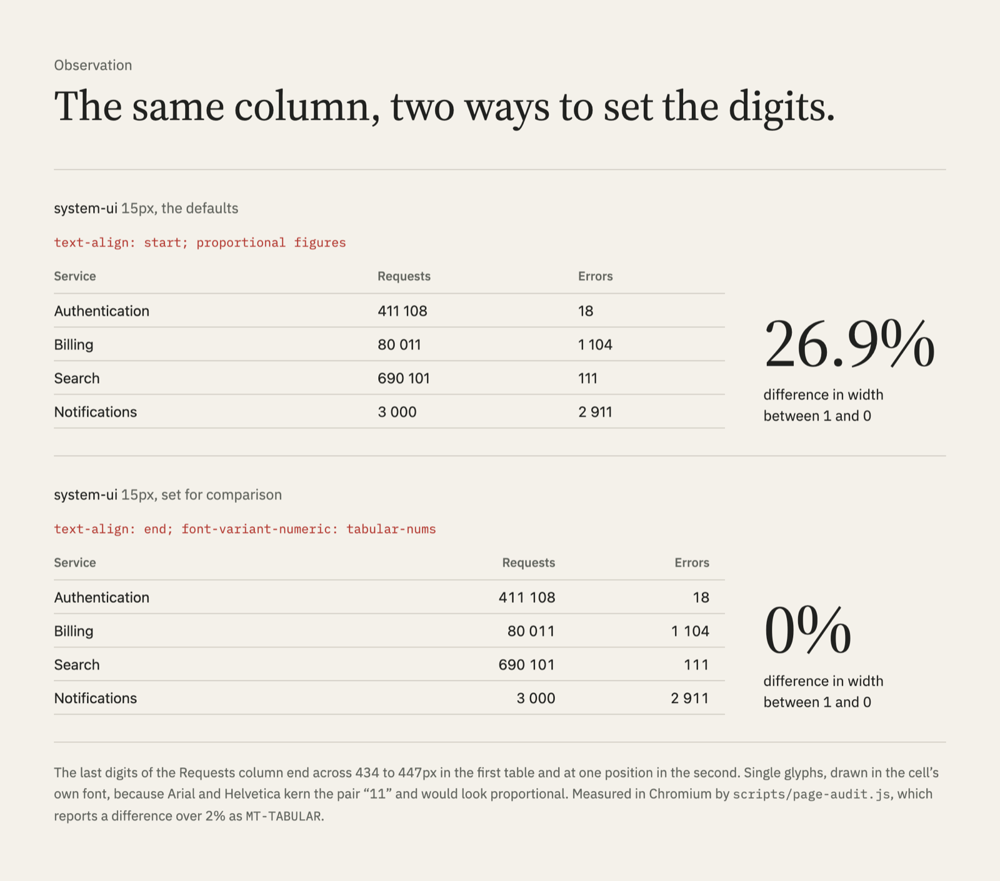
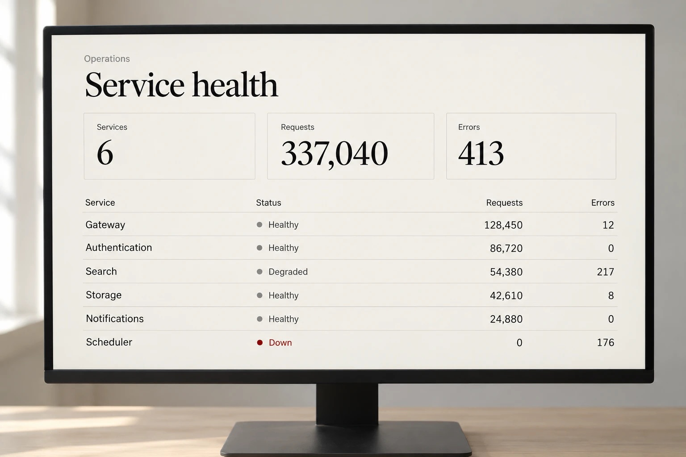

<h1><picture>
  <source media="(prefers-color-scheme: dark)" srcset=".github/brand/readme-header-dark.svg">
  <source media="(prefers-color-scheme: light)" srcset=".github/brand/readme-header-light.svg">
  
</picture></h1>

[](skills/measured-type/SKILL.md)
[](#evidence)
[](LICENSE)
[](https://github.com/PetriLahdelma/measured-type/commits/main)
[](https://github.com/PetriLahdelma/measured-type/stargazers)

**[Install](#install)**&emsp;[Where it helps](#where-it-helps-what-it-costs-when-to-skip-it)&emsp;[Evidence](#evidence)&emsp;[Read the skill](skills/measured-type/SKILL.md)&emsp;[Support](#support-measured-type)&emsp;[License](#license)

Measured Type is an agent skill for web typography: Bringhurst's rules
translated into current CSS and scripts that measure what can be measured
(line length, zoom growth, contrast, figures in a number column, font
coverage) in a real browser or in the font file. It is for design engineers,
frontend developers and design-system teams who let agents set and review
text.

<p>
<picture>
  <source media="(prefers-color-scheme: dark)" srcset=".github/brand/zoom-200-dark.png">
  <source media="(prefers-color-scheme: light)" srcset=".github/brand/zoom-200-light.png">
  
</picture>
</p>

| At 200% zoom on a 1280px window | 100% | 200% | Growth |
|---|--:|--:|--:|
| Body text, `1rem` | 16.0px | 32.0px | 2.00× |
| Hero written without the skill | 57.0px | 90.4px | 1.58× |
| Hero written with the skill | 65.6px | 112.3px | 1.71× |

Zoom doubles `rem` but halves the CSS viewport, so the viewport term in a
fluid size stops growing. In the development benchmark both runs without the
skill shipped heroes like the second row; with it, both did the ratio math
first. WCAG 1.4.4 sets no ratio of its own; the 1.6× bar is this project's.

## Where it helps, what it costs, when to skip it

**Where it helps**

- Fluid type under zoom, the largest gap in the development benchmark and
  the one place the 2×2 found the guidance itself helping.
- Line length in a wide face: `66ch` in Verdana sets 81 characters; the
  skill counts lines instead of trusting the unit.
- Right-to-left audits that convert text flow but leave decoration and
  already-mirrored glyphs alone.
- Dense product UI: tabular figures, numbers aligned at the end, tracked
  capitals, truncated text, contrast in both colour schemes.
- Agents without a browser of their own: the bundled Chromium measures, and
  without it the tools say what they could not check.
- Teams: one report format with rule IDs, severities and a Block or Approve
  verdict that can gate a pull request.

**What it costs**

- 7% to 25% more tokens and up to twice the time per task, measured across
  every experiment in [Evidence](#evidence).
- `npm install` and a Chromium download for the measuring scripts (the
  linter and the estimate need neither).
- The text is CC BY-NC 4.0; whether paid client work may use it is not
  settled ([License](#license)).

**When to skip it**

- A capable model with a browser, told to measure, set line length as well
  as the skill did; the guidance's one measured gain, on fluid type under
  zoom, is small.
- One-off questions a current model already answers well.
- Logos, drawing icons or fonts, build setup.

It rarely loads on its own (about one run in ten): name it when you want it.

## How it works

1. **Classify the text.** Reading, display and interface text follow
   different rules; book rules applied to a button are their own mistake.
2. **Direction and language first.** Every rule is flow-relative, with `lang`
   and `dir` in place, so an RTL or vertical edition is a content change.
3. **Decide with the rules.** Bringhurst's [*The Elements of Typographic Style*](https://www.amazon.com/dp/0881792128),
   numbered so reviews can cite `§2.1.2`, translated into CSS that ships today.
4. **Measure what can be measured,** and when no browser is available,
   estimate and say so. Anything a check cannot compute is listed under Not
   verified, never passed in silence.
5. **Review with a point of view.** A taste reference for what reads as
   considered and the template tells that read as defaults.

## Install

**skills CLI** ([skills.sh](https://skills.sh)), as a personal skill in every
project:

```bash
npx skills add PetriLahdelma/measured-type --skill measured-type --agent claude-code -g
```

Leave out `-g` to install into the current project, or `--agent` to choose
other agents. Tested with skills 1.7.4 on macOS, 29 October 2026. Without the
CLI, copy `skills/measured-type` from a clone into `~/.claude/skills/`, or use
`gh skill install PetriLahdelma/measured-type measured-type` (preview).

**The measuring scripts** are optional; without them the skill advises but
cannot measure:

```bash
cd ~/.claude/skills/measured-type && npm install && npx playwright install chromium
```

```bash
pip install fonttools brotli
```

**Check the install** with `npm test` in the same folder. A few tests skip in
an installed copy because their fixtures live in this repository; the
estimate calibration skips where its macOS fonts are not installed.

## Use it

Name the skill. A first task, in a project with a stylesheet:

> *Use measured-type to audit the typography in styles.css and fix the HIGH findings. Measure the line length in the browser.*

Tasks it is written for:

- *Set the article body for our docs in Verdana at 1.125rem, about 66 characters per line.*
- *Build a type scale for this site that still works at 200% zoom.*
- *Audit this stylesheet before we ship the Arabic edition.*
- *Does our italic have real small caps?*
- *The numbers in our admin table don't line up and the status badges are hard to read.*

It works alongside general frontend and design-system skills: they keep layout
and components, this one makes the type decisions inside them.

**Without installing anything.** The linter and the estimate need only Node:

```bash
node ~/.claude/skills/measured-type/scripts/estimate-measure.js "Verdana" 66ch
```

```text
about 81 characters per line in Verdana at 66ch (estimate from a Chromium calibration, not a measurement)
  671.6px at 16px; average character 0.504em, zero 0.636em
```

## What it measures

| Script | What it does |
|---|---|
| [`page-audit.js`](skills/measured-type/scripts/page-audit.js) | Audits a rendered page at 1280, 768 and 375px and at 200%, 400% and 500% zoom: reflow, characters per line, contrast in light and dark schemes, the WCAG 1.4.12 spacing override, fonts that fell back, zoom growth and the screen and product UI checks. `--lite` lints instead when there is no browser |
| [`lint-css.js`](skills/measured-type/scripts/lint-css.js) | Lints CSS, SCSS, Less, HTML, component style blocks and Tailwind classes (also inside `cn()`, `clsx()`, Vue `:class` and Svelte `class:`), or only what a branch changed (`--diff`). Fluid sizes are evaluated at zoom. No dependencies |
| [`measure-line.js`](skills/measured-type/scripts/measure-line.js) | Counts characters per line of one selector, graphemes and columns counted correctly |
| [`estimate-measure.js`](skills/measured-type/scripts/estimate-measure.js) | Estimates characters per line without a browser, from a Chromium calibration of 30 faces |
| [`font-features.py`](skills/measured-type/scripts/font-features.py) | Reports which OpenType features a font file really covers, per file (roman and italic can differ) |
| [`fallback-metrics.py`](skills/measured-type/scripts/fallback-metrics.py) | Builds a metric-matched fallback `@font-face`, so the web font swaps in without reflow |
| [`type-scale.js`](skills/measured-type/scripts/type-scale.js) | Prints fluid type tokens, each checked for range, zoom growth and step ratio |

Every script was written test first ([`specs/`](specs/)); both audits
report in one format ([`references/audit.md`](skills/measured-type/references/audit.md)).
The audit of the ops dashboard from head-to-head 2 and 3
([`evals/h2h-dashboard/`](evals/h2h-dashboard/files/)), with the Fix column
and half the rows left out:

| Severity | Rule | Location | Measured |
|---|---|---|---|
| HIGH | MT-CONTRAST | `p.foot` | 2.23:1 (rgb(170, 170, 170) on rgb(250, 250, 250), needs 4.5:1) |
| HIGH | MT-REFLOW | `table.services` at 320 CSS px (400% zoom of 1280) | page is 924px wide in a 320px viewport |
| MEDIUM | MT-TABULAR | `table.services` columns 3, 4 and 5 | 1 and 0 differ by 26.8% in width, so digits do not line up |
| LOW | MT-CAPS-TRACKING | `p.eyebrow`, `p.kpi-label`, `th` | capitals at 11px with letter-spacing 0px (under 0.03em) |
| LOW | MT-NUM-ALIGN | `table.services` columns 3, 4 and 5 | numbers of different lengths set text-align: left |
| LOW | MT-TRUNCATE | `td > span.name` | "Authentication gateway for partner accounts" cut at 1280px |
| LOW | MT-UI-SIZE | `p.foot` | 10px interface text (house floor 12px) |

Verdict: Block (9 HIGH).

Product UI fails differently from an article:
nothing is too long to read, but it is hard to compare. Proportional figures
cannot line up, so 411 108 and 80 011 end at different edges even in a
column of their own:

<p>
<picture>
  <source media="(prefers-color-scheme: dark)" srcset=".github/brand/tabular-figures-dark.png">
  <source media="(prefers-color-scheme: light)" srcset=".github/brand/tabular-figures-light.png">
  
</picture>
</p>

## More proof

**`ch` is the width of the zero.** The same `66ch` sets different measures in
different faces, so the skill counts the rendered lines:

<p>
<picture>
  <source media="(prefers-color-scheme: dark)" srcset=".github/brand/measure-66ch-dark.png">
  <source media="(prefers-color-scheme: light)" srcset=".github/brand/measure-66ch-light.png">
  
</picture>
</p>

| `max-inline-size: 66ch` at 16px | Verdana | Source Serif 4 |
|---|--:|--:|
| Width of the zero, `1ch` | 0.64em | 0.52em |
| Box width | 671px | 548px |
| Characters per full line | 81 | 70 |

Asked for about 66 characters per line in Verdana, the skill set the box in
`em` and checked it with `measure-line.js`: 66.1 characters per line, range 60
to 71, in a box of `34.5em` (`54.3ch`).

**A feature tag is not coverage.** `font-features.py` reads the file: Source
Serif 4's roman has complete small caps and its italic has none, although
both files list the same family.

<details>
<summary>The report for the italic</summary>

```text
# Source Serif 4 Italic  (SourceSerif4-Italic[opsz,wght].ttf)
italic: yes
default figures: tabular lining
GSUB: aalt case ccmp dnom frac liga lnum locl numr onum ordn pnum sinf ss01 ss02 ss03 subs sups tnum zero

  smcp: ABSENT  (small caps from lowercase: should cover a-z and accented letters)
  c2sc: ABSENT  (small caps from capitals: should cover A-Z and accented capitals)

check smcp: absent
  missing: abcdefghijklmnopqrstuvwxyzäöå
```

</details>

**One article set twice.** The "before" uses template defaults; no model
wrote it:

<p>

</p>

[`examples/editorial/`](examples/editorial/) holds both pages and a table of
every change with the section it follows. The audit blocks `before.html` with
4 HIGH findings and approves `after.html`.

## In CI and pull requests

The linter exits 1 when a HIGH finding remains, so it can gate a pull request
with no install. `--diff` limits it to what the branch changed, which lets an
older codebase adopt it gradually:

```bash
node path/to/measured-type/scripts/lint-css.js src --diff origin/main
```

The rendered audit needs Playwright and a page: point it at a preview
deployment or a built HTML file. Exit codes for both: 0 approve, 1 block, 2
usage error.

## Reference, by decision

| You are deciding | Read |
|---|---|
| How wide a column of text should be | [Choose a comfortable measure](skills/measured-type/references/rules.md#212-choose-a-comfortable-measure), then [`measure-line.js`](skills/measured-type/scripts/measure-line.js) |
| Leading and the space between blocks | [Vertical space in measured intervals](skills/measured-type/references/rules.md#222-add-and-delete-vertical-space-in-measured-intervals) |
| A type scale that survives zoom | [Building or reviewing a type scale](skills/measured-type/SKILL.md#building-or-reviewing-a-type-scale) and [Don't compose without a scale](skills/measured-type/references/rules.md#311-dont-compose-without-a-scale) |
| Whether a font has real small caps or text figures | [Checking what a font contains](skills/measured-type/references/rules.md#checking-what-a-font-contains), then [`font-features.py`](skills/measured-type/scripts/font-features.py) |
| Spacing for capitals, labels and acronyms | [Letterspace capitals and small caps](skills/measured-type/references/rules.md#216-letterspace-capitals-small-caps-and-long-digit-strings) |
| Data tables, labels, badges and status text | [Dense product UI](skills/measured-type/references/product-ui.md) |
| Inline code, icons beside labels, heading order, pairing faces, kerning, thin weights | [Screen and interface type](skills/measured-type/references/screen-and-ui.md) |
| Where hard spaces go | [Link short numerical expressions](skills/measured-type/references/rules.md#246-link-short-numerical-expressions-with-hard-spaces) |
| Making a layout work right to left | [Physical to logical map](skills/measured-type/references/logical-and-language.md#physical-to-logical-map) and [Mirroring](skills/measured-type/references/logical-and-language.md#mirroring) |
| Quotes, decimals, units and dates for a locale | [Locale conventions](skills/measured-type/references/logical-and-language.md#locale-conventions-the-pattern), worked for English, Finnish and Swedish |
| Replacing CSS that was renamed or never shipped | [Renamed, dead or wrong](skills/measured-type/references/css-modern.md#renamed-dead-or-wrong) |
| Whether the result looks considered | [Reviewing with a point of view](skills/measured-type/references/taste.md#reviewing-with-a-point-of-view) |

## Evidence

The head-to-heads ran on Claude Opus 5.5 on 29 October 2026 (head-to-head 3
added Sonnet 5.5), two runs per cell; the 2×2 ran on Sonnet 5.5 on 30 October,
five runs per cell. Cases and graders were committed before the runs, and
every result is reproducible from the committed run files.

| Experiment | What ran | With the skill | Without | What it shows |
|---|---|--:|--:|---|
| [Development set](evals/results/iteration-2/) | 5 cases written with the skill | 78/78 | 65/78 | The content reaches the agent; most misses are house conventions, three are errors a reader would see |
| [Held-out](evals/results/heldout-2/) | 3 cases written after the content was frozen | 34/34 | 33/34 | No measurable difference |
| [Head-to-head 1](evals/results/h2h-1/) | 3 cases, 7 configurations | 40/40 | 39/40 | A tie with frontend-design at 40/40 under the corrected graders; one assertion is noise |
| [Head-to-head 2](evals/results/h2h-2/) | Dense dashboard and a 66-character measure, browser offered to all | 24/24 | 24/24 | With a browser, a model without the skill measures and fixes the same faults |
| [Head-to-head 3](evals/results/h2h-3/) | Same cases, no browser in the brief, Opus and Sonnet | 48/48 | 48/48 | Runs with the skill landed on 66 characters per line, two without it at 62.5 and 63.4; the skill's runs had its bundled Chromium, so the gain comes from the tooling |
| [2×2](evals/results/2x2/) | Skill and browser varied independently, 66-character measure and a fluid hero under zoom, Sonnet, 40 runs | 51/60 | 50/60 | Line length follows the browser; on the hero the skill raised growth at 200% zoom with or without one (1.53× against 1.43× to 1.45×), though 9 of its 10 runs still missed the 1.6× bar |
| [Triggering](evals/triggering/) | 16 typography prompts, 16 near misses, 3 runs each | 5 of 48 loads | | Rarely loads on its own; never loads for a near miss |

**How to read it.** The 2×2 separates the skill's guidance from its
measuring tools. On line length the browser does the work: with one, runs
with and without the skill came equally close to 66 characters (p = 0.52);
without one, the skill's estimator brought its runs about one character
closer than a model guessing (p = 0.008), all inside the graded band. On the
fluid hero the guidance helped with or without a browser (p = 0.008 and
0.048): the skill's runs traded some desktop size for growth under zoom. That
gain is small and is measured against this project's own 1.6× bar, which only
the skill's runs were told about. Before the 2×2, the guidance changed nothing
measurable on the cases written after the content was frozen, and a model
told it has a browser matched the skill. The development set shows that the
content reaches the agent, but the references contain worked answers for some
of those cases; most of the baseline's misses there are conventions this
project chose (the 1.6× zoom bar, the 1.15× step floor, spacing from the body
line). Not yet tested: a one-sentence hint against the full skill, ten runs
per cell and models other than Claude.

Each results folder has the method, every run's output, grade and timing, and
every correction and incident. How to run the cases yourself:
[`evals/README.md`](evals/README.md).

## Pairs with Rhythmguard

[**Rhythmguard**](https://github.com/PetriLahdelma/stylelint-plugin-rhythmguard),
a Stylelint plugin by the same author, keeps every spacing value (and, opt in,
every type size) on your scale. Measured Type decides whether the scale reads
well. They meet only at the type scale: `type-scale.js --prefix font-size`
writes tokens Rhythmguard reads as its typography scale, and its README has
[the config](https://github.com/PetriLahdelma/stylelint-plugin-rhythmguard#type-pair-it-with-measured-type).

On one stylesheet, run with Stylelint 17.16 and Rhythmguard 3.14.0, each tool
finds what the other leaves alone:

| Finding | Reported by |
|---|---|
| `padding: 13px` and `font-size: 17px`, off the scale | Rhythmguard |
| `font-size: 3vw`, which never doubles under zoom | Measured Type |
| `text-transform: uppercase` with no tracking | Measured Type |
| `max-inline-size: 66ch` in Verdana, about 81 characters per line | Measured Type |

## Identity

<p>
  
  
</p>
<p>
  
</p>
<p><sub>Generated illustrations of the identity. They show no measurement.</sub></p>

## Support Measured Type


Measured Type is free to use. If it saves you time, optional sponsorship helps
keep it measured and maintained. Issues with a reproducible case, new eval
cases and corrections to the references are welcome contributions too.

[](https://github.com/sponsors/PetriLahdelma)
[](https://buymeacoffee.com/petrilahdey)

## License

Text (SKILL.md, references and eval prose) is CC BY-NC 4.0 because it adapts
Richard Rutter's [webtypography.net](https://webtypography.net), which is
published under that license. Scripts are MIT. The test fonts are under the
SIL Open Font License. The Measured Type name and the artwork in
`.github/brand/` identify this project and are not licensed for other use.
See [LICENSE](LICENSE); the skill folder carries its own copy of the notices,
so an installed skill keeps them.

**Can I use it in paid work?** The scripts, MIT, can be used anywhere. The
text is CC BY-NC 4.0, which restricts uses primarily intended for commercial
advantage. Whether an agent consulting it during paid client work is such a
use has not been settled with the rights holders; this README does not
settle it. If it matters for your work, read the license or ask before you
rely on it.

The rules follow Robert Bringhurst's
[*The Elements of Typographic Style*](https://www.amazon.com/dp/0881792128) and
the rule order of webtypography.net. They are paraphrased and the CSS is
rewritten for current browsers. The skill is a working translation, not a
substitute: if it is useful to you, buy the book. The wordmark is set in
Source Serif 4 by Adobe; the brand's interface type is IBM Plex. Both are
released under the OFL.

Measured Type is an independent project. It is not affiliated with, endorsed
by or sponsored by Robert Bringhurst, Richard Rutter, webtypography.net, Matej
Latin, Ina Saltz or the publishers of their books; their names appear only to
credit the sources.
