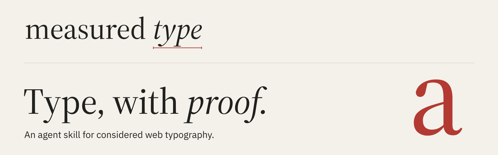
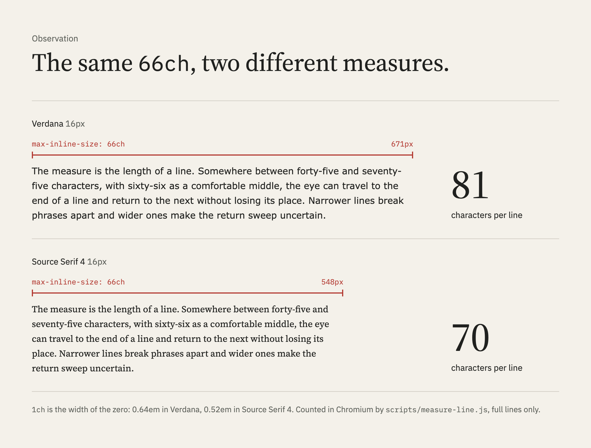
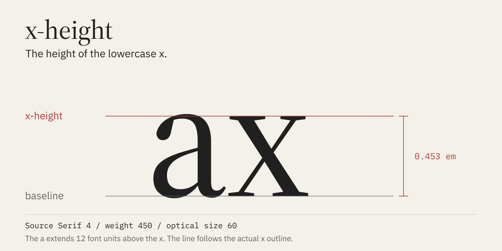

<picture>
  <source media="(prefers-color-scheme: dark)" srcset=".github/brand/readme-header-dark.svg">
  <source media="(prefers-color-scheme: light)" srcset=".github/brand/readme-header-light.svg">
  
</picture>

[](skills/measured-type/SKILL.md)
[](evals/results/iteration-1/benchmark.md)
[](LICENSE-CC-BY-NC-4.0.txt)
[](LICENSE-MIT.txt)
[](https://github.com/PetriLahdelma/measured-type/commits/main)
[](https://github.com/PetriLahdelma/measured-type/stargazers)
[](https://github.com/sponsors/PetriLahdelma)
[](https://buymeacoffee.com/petrilahdey)

**[Install](#install)**&emsp;[Read the skill](skills/measured-type/SKILL.md)&emsp;[View the evaluations](evals/results/iteration-1/benchmark.md)&emsp;[License](#license)

Measured Type brings typographic judgment into a coding agent's workflow, with
tools for checking the parts that can be measured. It is for design engineers,
frontend developers and design-system teams who use agents to set and review
text.

Most typography advice ends at a rule of thumb. This skill goes one step
further: when a claim can be checked, it is checked in a browser or against the
font file. The number goes into the answer.

## Install

**Claude Code**, as a personal skill available in every project:

```bash
git clone https://github.com/PetriLahdelma/measured-type.git
```

```bash
cp -R measured-type/skills/measured-type ~/.claude/skills/
```

For one project only, copy it to `.claude/skills/` in that repository instead.

**GitHub CLI** (`gh skill`, preview), for Claude Code or any other supported
agent:

```bash
gh skill install PetriLahdelma/measured-type measured-type --agent claude-code --scope user
```

**The measuring scripts** are optional. The skill works without them but cannot
measure:

```bash
cd ~/.claude/skills/measured-type && npm install && npx playwright install chromium
```

```bash
pip install fonttools brotli
```

Then ask the way you normally would. The skill loads whenever the work sets
text people read, whether or not the word typography appears:

- *Set the article body for our docs in Verdana at 1.125rem, about 66 characters per line.*
- *Build a type scale for this site that still works at 200% zoom.*
- *Audit this stylesheet before we ship the Arabic edition.*
- *Does our italic have real small caps?*

## What it catches

Each row is a finding from the committed benchmark, in the words the skill
uses to report it.

| Observation | In the benchmark |
|---|---|
| **The heading grows too little under zoom.** A `clamp()` with a viewport term does not double when the reader zooms to 200%. | Without the skill, both runs let the hero grow only 1.44× at 200% zoom; the case asks for at least 1.6×. With the skill, both runs did the ratio math first and passed. |
| **`75ch` in Verdana is not 75 characters.** `1ch` is the width of the zero, which is wider than the average letter. | Neither run without the skill noticed that the audited column renders 92 characters per line. |
| **The shadow is decoration, not direction.** An RTL audit converts text flow and leaves decorative offsets alone. | Both runs without the skill mirrored a decorative `box-shadow` and `rotate()`. |
| **The qualifier can break from its number.** "up to 18 h" needs hard spaces in two places, not one. | One run without the skill left a breakable space inside "up to". |
| **The italic file has no small-cap substitutions.** A feature tag in the roman says nothing about the italic. | All four runs caught this; the bundled script makes it a one-command check instead of a careful reading. |

The references also cover traps the benchmark does not test: `rlh` is the body
line only when the body is set at the root size; `Intl.NumberFormat` with
`style: 'unit'` emits a plain space that lets "18 h" break. A half-line margin
under a heading collapses into the next element's full-line margin, so the half
line silently becomes a full one.

## Proof, not rules of thumb

<picture>
  <source media="(prefers-color-scheme: dark)" srcset=".github/brand/measure-66ch-dark.png">
  <source media="(prefers-color-scheme: light)" srcset=".github/brand/measure-66ch-light.png">
  
</picture>

Every number in this figure was counted in the rendered page, not computed from
the CSS. The same count is one command away. Asked for about 66 characters per
line in Verdana, the skill set the box in `em`, not `ch`, then checked it:

```bash
node scripts/measure-line.js --css prose.css
```

```text
.prose > p at 1280px, zoom 1: 66.1 chars/line (inside 45-75)
  range 60-71 over 20 full lines in 4 paragraphs
  Verdana, "DejaVu Sans", "Bitstream Vera Sans", sans-serif 18px, line-height 28.8px
  box 621px = 54.3ch = 34.5em
  zero 0.636em vs average character 0.522em
```

`54.3ch` for 66 characters: the last line says why.

### Font files, not font names

A feature tag is not coverage. `scripts/font-features.py` reads the file and
counts what each text feature actually maps. Source Serif 4 is a good example:
the roman has complete small caps and the italic has none.

```bash
python3 scripts/font-features.py "SourceSerif4-Italic[opsz,wght].ttf" --check smcp=abcdefghijklmnopqrstuvwxyzäöå
```

```text
# Source Serif 4 Italic  (SourceSerif4-Italic[opsz,wght].ttf)
italic: yes
GSUB: aalt case ccmp dnom frac liga lnum locl numr onum ordn pnum sinf ss01 ss02 ss03 subs sups tnum zero

  smcp: ABSENT  (small caps from lowercase: should cover a-z and accented letters)
  c2sc: ABSENT  (small caps from capitals: should cover A-Z and accented capitals)

check smcp: absent
  missing: abcdefghijklmnopqrstuvwxyzäöå
```

(Excerpt; the full report lists every feature with its coverage.)

The same habit applies to metrics. Font metadata describes the design, while
the outline is what the reader sees:



At weight 450 and optical size 60, the drawn x of Source Serif 4 is 0.453em
tall, while the `OS/2` table's `sxHeight` field says 475 units. Position a rule
from the outline and it lands on the letter.

## How it works

1. **Classify the text first.** Reading, display and interface text follow
   different rules; book rules applied to a button are their own mistake.
2. **Direction and language before anything else.** Every rule is written
   flow-relative, with `lang` and `dir` in place, so an RTL or vertical edition
   is a content change rather than a rewrite.
3. **Decide with the rules.** Bringhurst's [*The Elements of Typographic Style*](https://www.amazon.com/dp/0881792128),
   numbered so reviews can cite `§2.1.2`, translated into CSS that ships today.
4. **Measure what can be measured.** Characters per line, zoom ratios,
   rendered hard spaces, font coverage.
5. **Review with a point of view.** A taste reference for what reads as
   considered and for the template tells that read as defaults.

## Reference, by decision

Open the part that answers the question in front of you.

| You are deciding | Read |
|---|---|
| How wide a column of text should be | [Choose a comfortable measure](skills/measured-type/references/rules.md#212-choose-a-comfortable-measure), then [`measure-line.js`](skills/measured-type/scripts/measure-line.js) |
| Leading and the space between blocks | [Vertical space in measured intervals](skills/measured-type/references/rules.md#222-add-and-delete-vertical-space-in-measured-intervals) |
| A type scale that survives zoom | [Building or reviewing a type scale](skills/measured-type/SKILL.md#building-or-reviewing-a-type-scale) and [Don't compose without a scale](skills/measured-type/references/rules.md#311-dont-compose-without-a-scale) |
| Whether a font has real small caps or text figures | [Checking what a font contains](skills/measured-type/references/rules.md#checking-what-a-font-contains), then [`font-features.py`](skills/measured-type/scripts/font-features.py) |
| Spacing for capitals, labels and acronyms | [Letterspace capitals and small caps](skills/measured-type/references/rules.md#216-letterspace-capitals-small-caps-and-long-digit-strings) |
| Where hard spaces go | [Link short numerical expressions](skills/measured-type/references/rules.md#246-link-short-numerical-expressions-with-hard-spaces) |
| Making a layout work right to left | [Physical to logical map](skills/measured-type/references/logical-and-language.md#physical-to-logical-map) and [Mirroring](skills/measured-type/references/logical-and-language.md#mirroring) |
| Quotes, decimals, units and dates for a locale | [Locale conventions](skills/measured-type/references/logical-and-language.md#locale-conventions-the-pattern), worked for English, Finnish and Swedish |
| Replacing CSS that was renamed or never shipped | [Renamed, dead or wrong](skills/measured-type/references/css-modern.md#renamed-dead-or-wrong) |
| Whether the result looks considered | [Reviewing with a point of view](skills/measured-type/references/taste.md#reviewing-with-a-point-of-view) |

## Evidence

**Method.** Five eval cases, each run twice with the skill and twice without it,
on Claude Opus 5.5 on 29 October 2026. Graders read only the files each run
produced. Rendered claims (line length, zoom ratios, the characters in the DOM)
were measured in Chromium, not read off the source.

| Case | With skill | Without | What decides it |
|---|--:|--:|---|
| zoom-safe-scale | 10/10 | 4/10 | Hero kept to 1.6× or more at 200% zoom; h3 and h4 still 1.15× apart at 360px; spacing from the body line |
| rendered-nbsp-spec-table | 12/12 | 9/12 | Logical properties; "up to" bound to its number |
| physical-props-audit | 25/26 | 22/26 | Decorative shadow and rotation left physical; `75ch` in Verdana named as 92 characters |
| ofl-feature-check | 16/16 | 15/16 | All font synthesis disabled, not only small caps |
| measure-wide-face | 14/14 | 13/14 | An h3 after an h2 spaced a full body line |
| **All assertions** | **77/78** | **63/78** | Mean per-run pass rate 99% against 77% |

**Scope.** Gains concentrate in specific cases. A current model without the
skill already knows most typographic CSS, measures line length on its own when
it can and gets locale number formatting right. The skill earns its place where
the model would otherwise trust a formula: fluid type under zoom (the clearest
gap, matching an earlier run of the same case), RTL audits that convert text
flow without touching decoration and small details such as binding a
qualifier to its number. On line length alone the baseline now measures Verdana
correctly by itself, so that case no longer separates the two. With two runs
per configuration, treat a one-assertion difference as noise.

**Cost.** Runs with the skill took about 35 seconds and 21k tokens more each,
spent reading references and running the scripts.

The outputs, grades and timings of every run are in
[`evals/results/`](evals/results/iteration-1/).

## Running the evals

The cases in `evals/` use the layout that `claude plugin eval` and the
skill-creator workflow read: `prompt.md`, `case.yaml`, one grader file per
assertion and input files under `files/`. The runs read the skill directly, so
they measure its content, not whether it triggers. To recheck a committed
result:

```bash
node skills/measured-type/scripts/measure-line.js --css evals/results/iteration-1/measure-wide-face/with_skill/run-1/outputs/prose.css
```

The `ofl-feature-check` outputs reference `fonts/`; copy
`evals/ofl-feature-check/files/fonts/` next to them first. The results folder
does not duplicate the font files.

## Support Measured Type

Measured Type is free to use. If it saves you time, optional sponsorship helps
keep it measured and maintained. Issues with a reproducible case, new eval
cases and corrections to the references are welcome contributions too.

[](https://github.com/sponsors/PetriLahdelma)
[](https://buymeacoffee.com/petrilahdey)

## License

Text (SKILL.md, references and eval prose) is CC BY-NC 4.0 because it adapts
Richard Rutter's [webtypography.net](https://webtypography.net), which is
published under that license. Scripts are MIT. The test fonts are under the
SIL Open Font License. The Measured Type name and the artwork in
`.github/brand/` identify this project and are not licensed for other use.
See [LICENSE](LICENSE).

The rules follow Robert Bringhurst's
[*The Elements of Typographic Style*](https://www.amazon.com/dp/0881792128) and
the rule order of webtypography.net. They are paraphrased and the CSS is
rewritten for current browsers. The skill is a working translation, not a
substitute: if it is useful to you, buy the book. The wordmark is set in Source Serif 4 by Adobe; the
brand's interface type is IBM Plex. Both are released under the OFL.
