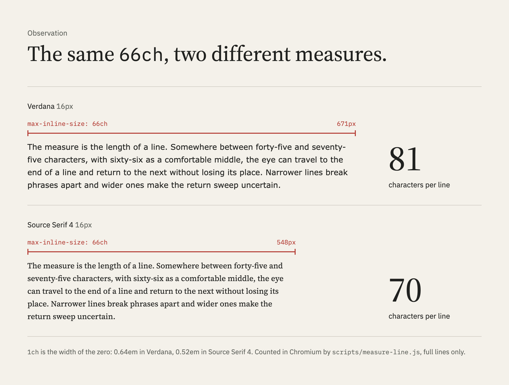
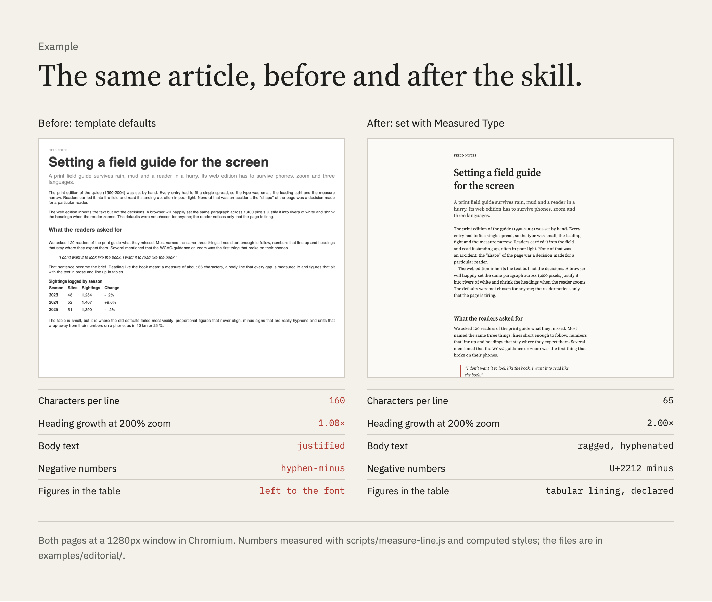

# Evidence

Every claim the [README](../README.md) makes about what the skill changes
rests on a committed run. The head-to-heads ran on Claude Opus 5.5 on 29
October 2026 (head-to-head 3 added Sonnet 5.5), two runs per cell; the 2×2
and spec 0008 ran on Sonnet 5.5 on 30 October, five and then ten runs per
cell; the triggering studies ran on 30 October and 5 November. Cases and
graders were committed before the runs, and every result is reproducible from
the committed run files.

## The experiments

| Experiment | What ran | With the skill | Without | What it shows |
|---|---|--:|--:|---|
| [Development set](../evals/results/iteration-2/) | 5 cases written with the skill | 78/78 | 65/78 | The content reaches the agent; most misses are house conventions, three are errors a reader would see |
| [Held-out](../evals/results/heldout-2/) | 3 cases written after the content was frozen | 34/34 | 33/34 | No measurable difference |
| [Head-to-head 1](../evals/results/h2h-1/) | 3 cases, 7 configurations | 40/40 | 39/40 | A tie with frontend-design at 40/40 under the corrected graders; one assertion is noise |
| [Head-to-head 2](../evals/results/h2h-2/) | Dense dashboard and a 66-character measure, browser offered to all | 24/24 | 24/24 | With a browser, a model without the skill measures and fixes the same faults |
| [Head-to-head 3](../evals/results/h2h-3/) | Same cases, no browser in the brief, Opus and Sonnet | 48/48 | 48/48 | Runs with the skill landed on 66 characters per line, two without it at 62.5 and 63.4; the skill's runs had its bundled Chromium, so the gain comes from the tooling |
| [2×2](../evals/results/2x2/) | Skill and browser varied independently, 66-character measure and a fluid hero under zoom, Sonnet, 40 runs | 51/60 | 50/60 | Line length follows the browser; on the hero the skill raised growth at 200% zoom with or without one (1.53× against 1.43× to 1.45×), though 9 of its 10 runs still missed the 1.6× bar |
| [Spec 0008](../evals/results/0008/) | A one-sentence hint against the skill, and the 2×2 at ten runs per cell, Sonnet, 80 more runs | 101/120 | 106/120 with the hint, 100/120 with nothing | The hint beat the skill on growth under zoom (1.63× against 1.50×), mostly by giving up the requested 72px; the skill came closer to 66 characters per line (0.25 against 1.54 off, with a browser) |
| [Spec 0009](../evals/results/0009/) | The hero case again after `type-scale.js --fit`, Sonnet, 20 runs | 20/20 met all three checks | 6/20 with the hint, 0/20 with nothing | Every run used the two-slope form `--fit` printed and kept both requested sizes (p < 0.001 against the skill before it); a development result on the case that motivated the change |
| [Spec 0010](../evals/results/0010/) | Held-out twin of the hero case (48 to 80px, new page and prompt), Sonnet, 30 runs | 10/10 met all three checks | 10/10 with the hint, 0/10 with nothing | A held-out gain over no skill (p < 0.0001); no detectable difference from one sentence, whose runs mostly reached 80px early and grew a little more |
| [Spec 0017](../evals/results/0017/) | Held-out line length: 62 characters in Charter at 19px, where `62ch` gives 76, Sonnet, 30 runs | 0.18 characters off on average | 0.82 with the hint, 0.43 with nothing | A held-out gain over one sentence (p = 0.004); no detectable difference from a model that measures without the skill (p = 0.077) |
| [Spec 0018](../specs/0018-tighter-bands.md) | Committed runs re-graded with bands of 2 characters and 5% of each size, after the fact | 20/20 within 2 characters of 66 | 2/10 with nothing and no browser, 1/10 with the hint and no browser | Exploratory: without a browser the skill's estimate is the clear gain; the wider bands hid it |
| [Triggering, stub command](../evals/triggering/) | 16 typography prompts, 16 near misses, 3 runs each, skill-creator's method | 5 of 48 loads | | The skill offered as a stub command in an empty folder, first tool call only: rarely loads |
| [Triggering, real session](../evals/triggering/) (spec 0016) | 26 typography prompts, 22 near misses, the skill installed in a small site, Opus and Sonnet, 3 runs each | 78/78 loads with Opus, 44/48 with Sonnet | no near miss loaded in 114 runs | Loads before the first edit on nearly every typography task; the stub-command figure was the setup |
| [Plain-words description](../evals/triggering/) (spec 0026 Q4) | The description rewritten for search against the shipped one, spec 0016's protocol, Opus and Sonnet, 3 runs each, 372 runs on one afternoon | plain words: Opus 26/26 prompts, Sonnet 15/16, 3 of 114 near-miss runs loaded | shipped wording, same day: Opus 16/16, Sonnet 6/6, 0 of 66 near-miss runs loaded | The shipped wording stays; words for search go in the manifest and the READMEs, which the model does not read before loading |

## How to read it

The 2×2 and spec 0008 separate the skill's guidance from its measuring tools
and from one sentence of advice. On line length the browser does most of the
work, and the skill adds a little on top: with a browser its runs came within
a quarter of a character of 66 on average, against 0.68 off without it
(p = 0.031, ten runs per cell) and 1.54 off with the hint (p = 0.0001);
without a browser its estimator beat a model guessing by about one character
(p = 0.010). Every run of every kind was inside the graded band. On the fluid
hero the skill raised growth under zoom (1.50× against 1.43×, p < 0.0001),
but one sentence naming the 1.6× bar raised it further (1.63×, p < 0.0001);
14 of the 20 runs with that sentence reached the bar by giving up the 72px
desktop size the task asked for, and no configuration reliably met both until
spec 0009 added `type-scale.js --fit`, after which all 20 runs with the skill
met both; that is the tool printing the answer, measured on the case that
motivated it. On a held-out twin (48 to 80px) the skill again met all three
checks in 10 of 10 runs against 0 of 10 without it, and the one-sentence hint
matched it (10 of 10). The bar is this project's own convention.

Before these experiments, the guidance changed nothing measurable on the
cases written after the content was frozen. The development set shows that
the content reaches the agent, but the references contain worked answers for
some of those cases; most of the baseline's misses there are conventions this
project chose (the 1.6× zoom bar, the 1.15× step floor, spacing from the body
line). Not yet tested: models other than Claude, and cases beyond these two
for the hint.

Each results folder has the method, every run's output, grade and timing, and
every correction and incident. How to run the cases yourself:
[`evals/README.md`](../evals/README.md).

## Proofs

### `ch` is the width of the zero

The same `66ch` sets different measures in different faces, so the skill
counts the rendered lines:

<p>
<picture>
  <source media="(prefers-color-scheme: dark)" srcset="../.github/brand/measure-66ch-dark.png">
  <source media="(prefers-color-scheme: light)" srcset="../.github/brand/measure-66ch-light.png">
  
</picture>
</p>

| `max-inline-size: 66ch` at 16px | Verdana | Source Serif 4 |
|---|--:|--:|
| Width of the zero, `1ch` | 0.64em | 0.52em |
| Box width | 671px | 548px |
| Characters per full line | 81 | 70 |

Asked for about 66 characters per line in Verdana, the skill set the box in
`em` and checked it with `measure-line.js`: 66.1 characters per line, range 60
to 71, in a box of `34.5em` (`54.3ch`).

### A feature tag is not coverage

`font-features.py` reads the file: Source Serif 4's roman has complete small
caps and its italic has none, although both files list the same family.

<details>
<summary>The report for the italic</summary>

```text
# Source Serif 4 Italic  (SourceSerif4-Italic[opsz,wght].ttf)
italic: yes
default figures: tabular lining
GSUB: aalt case ccmp dnom frac liga lnum locl numr onum ordn pnum sinf ss01 ss02 ss03 subs sups tnum zero

  smcp: ABSENT  (small caps from lowercase: should cover a-z and accented letters)
  c2sc: ABSENT  (small caps from capitals: should cover A-Z and accented capitals)

check smcp: absent
  missing: abcdefghijklmnopqrstuvwxyzäöå
```

</details>

### One article set twice

The "before" uses template defaults; no model wrote it:

<p>

</p>

[`examples/editorial/`](../examples/editorial/) holds both pages and a table
of every change with the section it follows. The audit blocks `before.html`
with 4 HIGH findings and approves `after.html`.
