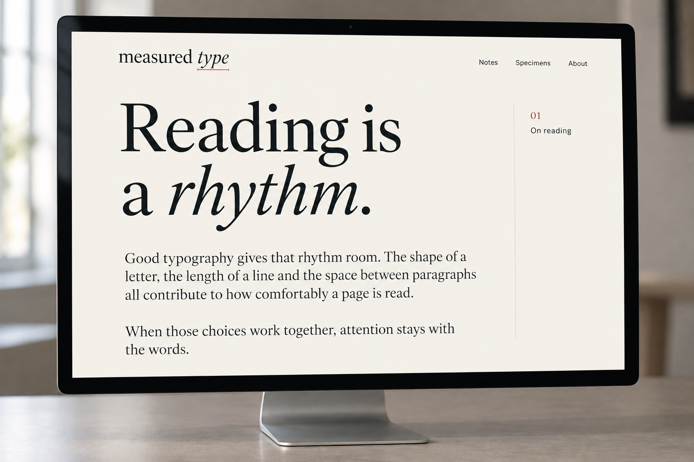
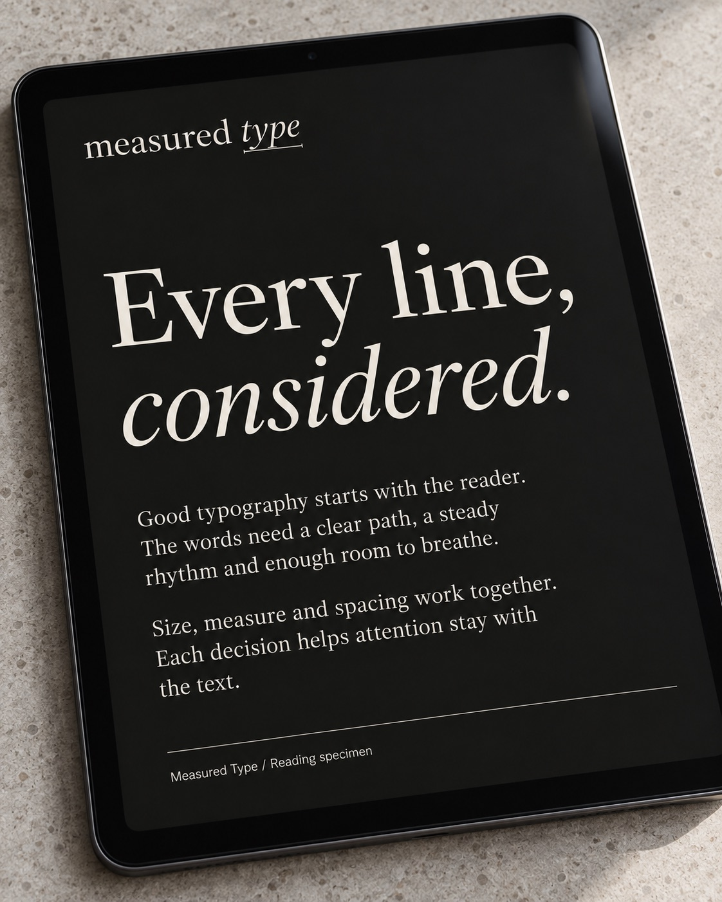
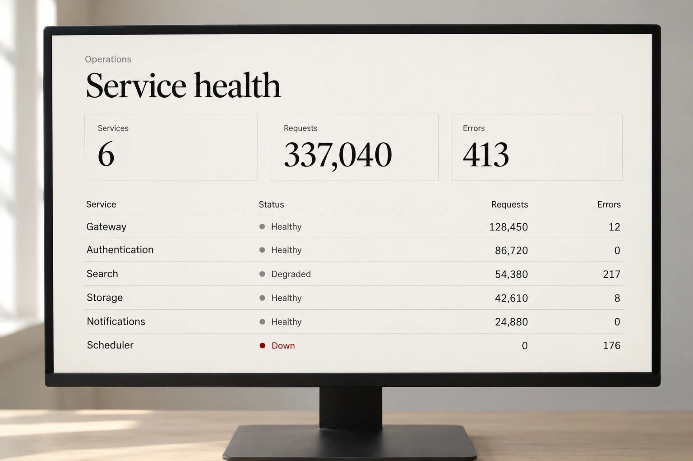
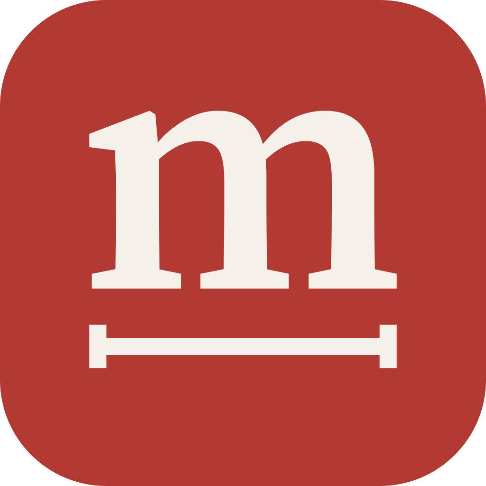

# Identity

The wordmark is set in Source Serif 4 by Adobe; the brand's interface type is
IBM Plex. Both are released under the OFL. The Measured Type name, the
wordmark and the artwork in `.github/brand/` identify this project and are not
licensed for other use; you may use them to refer to it.

  
  

  

Generated illustrations of the identity. They show no measurement.

  

