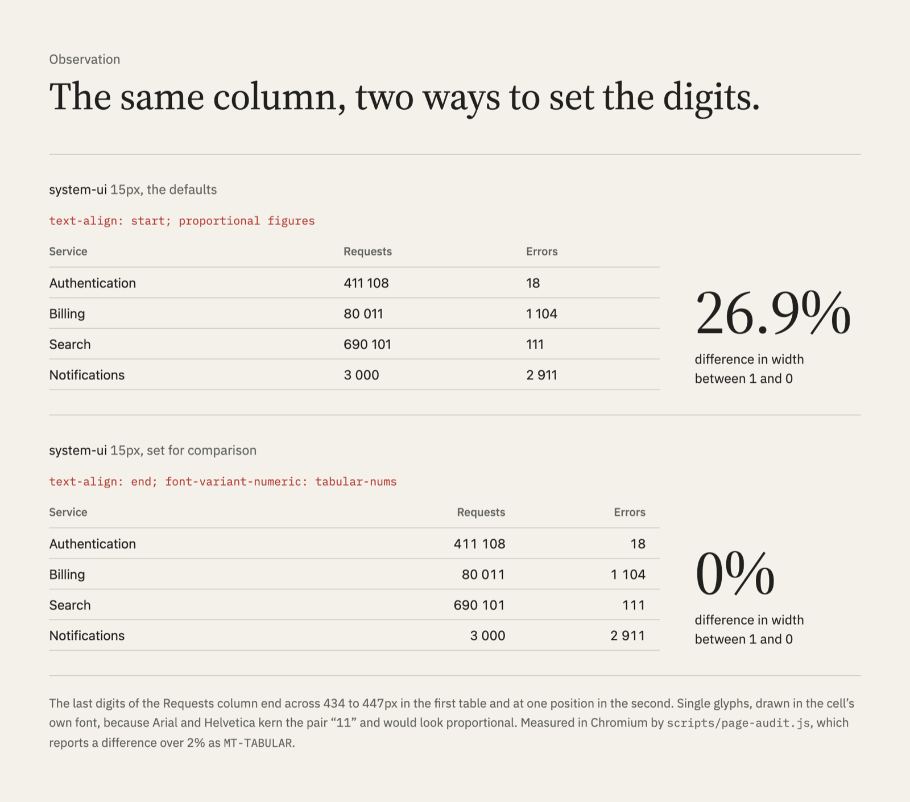

# The tools

Seven scripts, each written test first ([`specs/`](../specs/)), and one
report format for all of them
([`references/audit.md`](../skills/measured-type/references/audit.md)): rule
id, severity, where, the measured value and the CSS fix, then a verdict and
what could not be checked. Nothing is passed in silence.

## What each script does

| Script | What it does |
|---|---|
| [`page-audit.js`](../skills/measured-type/scripts/page-audit.js) | Audits a rendered page at 1280, 768 and 375px and at 200%, 400% and 500% zoom: reflow, characters per line, contrast in light and dark schemes, the WCAG 1.4.12 spacing override, fonts that fell back, zoom growth and the screen and product UI checks. `--baseline 8px` also checks a strict baseline grid: where each block's baselines land, more than 1px off is reported, with the line-height that caused it. The unit can be a custom property the page sets (`--baseline --u`, so it may change per breakpoint or region), checked at 1280, 768 and 375px, in one region (`--baseline-scope`) and to any tolerance (`--baseline-tolerance`). `--lite` lints instead when there is no browser |
| [`lint-css.js`](../skills/measured-type/scripts/lint-css.js) | Lints CSS, SCSS, Less, HTML, component style blocks and Tailwind classes (also inside `cn()`, `clsx()`, Vue `:class` and Svelte `class:`), or only what a branch changed (`--diff`). Fluid sizes are evaluated at zoom. No dependencies |
| [`measure-line.js`](../skills/measured-type/scripts/measure-line.js) | Counts characters per line of one selector, graphemes and columns counted correctly; `--solve 66` finds the `em` width that gives 66 |
| [`estimate-measure.js`](../skills/measured-type/scripts/estimate-measure.js) | Estimates characters per line without a browser, from a Chromium calibration of 30 faces |
| [`font-features.py`](../skills/measured-type/scripts/font-features.py) | Reports which OpenType features a font file really covers, per file (roman and italic can differ); `--metrics` gives x-height, cap height, extenders and width per em, compared to the first file, for pairing |
| [`fallback-metrics.py`](../skills/measured-type/scripts/fallback-metrics.py) | Builds a metric-matched fallback `@font-face`, so the web font swaps in without reflow |
| [`type-scale.js`](../skills/measured-type/scripts/type-scale.js) | Prints fluid type tokens, each checked for range, zoom growth and step ratio; `--fit MIN:MAX` keeps two requested sizes and passes the zoom bar |
| [`contrast-fix.js`](../skills/measured-type/scripts/contrast-fix.js) and [`apca.js`](../skills/measured-type/scripts/apca.js) | The nearest colour of the same hue that passes a ratio, and APCA Lc beside the WCAG ratio (advisory) |

## One report format

The audit of the ops dashboard from head-to-head 2 and 3
([`evals/h2h-dashboard/`](../evals/h2h-dashboard/files/)), with the Fix
column and half the rows left out:

| Severity | Rule | Location | Measured |
|---|---|---|---|
| HIGH | MT-CONTRAST | `p.foot` | 2.23:1 (rgb(170, 170, 170) on rgb(250, 250, 250), needs 4.5:1) |
| HIGH | MT-REFLOW | `table.services` at 320 CSS px (400% zoom of 1280) | page is 924px wide in a 320px viewport |
| MEDIUM | MT-TABULAR | `table.services` columns 3, 4 and 5 | 1 and 0 differ by 26.8% in width, so digits do not line up |
| LOW | MT-CAPS-TRACKING | `p.eyebrow`, `p.kpi-label`, `th` | capitals at 11px with letter-spacing 0px (under 0.03em) |
| LOW | MT-NUM-ALIGN | `table.services` columns 3, 4 and 5 | numbers of different lengths set text-align: left |
| LOW | MT-TRUNCATE | `td > span.name` | "Authentication gateway for partner accounts" cut at 1280px |
| LOW | MT-UI-SIZE | `p.foot` | 10px interface text (house floor 12px) |

Verdict: Block (9 HIGH).

Product UI fails differently from an article: nothing is too long to read,
but it is hard to compare. Proportional figures cannot line up, so 411 108
and 80 011 end at different edges even in a column of their own:

<p>
<picture>
  <source media="(prefers-color-scheme: dark)" srcset="../.github/brand/tabular-figures-dark.png">
  <source media="(prefers-color-scheme: light)" srcset="../.github/brand/tabular-figures-light.png">
  
</picture>
</p>

## Without a browser

`lint-css.js` and `estimate-measure.js` need only Node, no `npm install`:

```bash
node ~/.claude/skills/measured-type/scripts/estimate-measure.js "Verdana" 66ch
```

```text
about 81 characters per line in Verdana at 66ch (estimate from a Chromium calibration, not a measurement)
  671.6px at 16px; average character 0.504em, zero 0.636em
```

`page-audit.js --lite` lints a local page and its stylesheets and lists every
rendered check it skipped. When the browser is missing and `--lite` was not
asked for, the lite report still prints but the exit code is 3, so a gate
cannot pass on skipped checks.

## In CI and pull requests

The linter exits 1 when a HIGH finding remains, so it can gate a pull request
with no install. `--diff` limits it to what the branch changed, which lets an
older codebase adopt it gradually:

```bash
node path/to/measured-type/scripts/lint-css.js src --diff origin/main
```

The rendered audit needs Playwright and a page: point it at a preview
deployment or a built HTML file. Exit codes for both: 0 approve, 1 block, 2
usage error (a missing file, a bad flag, an error response from the page);
`page-audit.js` exits 3 when the browser is missing and its lite report
stood in, unless `--lite` asked for that. Both print JSON with `--json`.

## Pairs with Rhythmguard

[**Rhythmguard**](https://github.com/PetriLahdelma/stylelint-plugin-rhythmguard),
a Stylelint plugin by the same author, keeps every spacing value (and, opt in,
every type size) on your scale. Measured Type decides whether the scale reads
well. They meet only at the type scale: `type-scale.js --prefix font-size`
writes tokens Rhythmguard reads as its typography scale, and its README has
[the config](https://github.com/PetriLahdelma/stylelint-plugin-rhythmguard#type-pair-it-with-measured-type).

On one stylesheet, run with Stylelint 17.16 and Rhythmguard 3.14.0, each tool
finds what the other leaves alone:

| Finding | Reported by |
|---|---|
| `padding: 13px` and `font-size: 17px`, off the scale | Rhythmguard |
| `font-size: 3vw`, which never doubles under zoom | Measured Type |
| `text-transform: uppercase` with no tracking | Measured Type |
| `max-inline-size: 66ch` in Verdana, about 81 characters per line | Measured Type |

A strict baseline grid splits the same way. Rhythmguard's
`editorial-baseline` presets keep spacing values on a 4 or 6 unit cadence in
the source; whether the text then sits on the grid depends on the font that
loads, so `page-audit.js --baseline` measures it in the browser
([spec 0020](../specs/0020-baseline-grid.md)).
